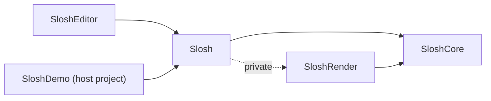
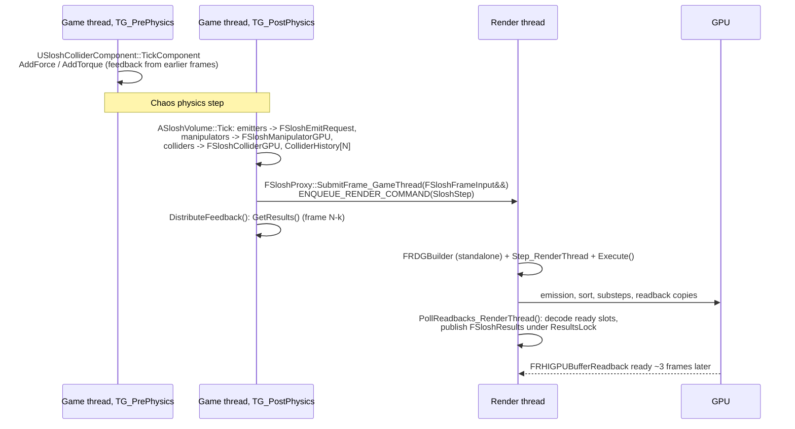

# Slosh architecture

This document describes how the Slosh plugin is put together: modules, threads, the per-frame GPU timeline,
every persistent GPU resource and its memory layout, the asynchronous feedback path, and the procedure for
adding a compute pass. It is written for an engineer who has to change the solver.

The numerical method itself (what each kernel computes and why) is in [Simulation.md](Simulation.md). The
screen-space renderer and surface reconstruction are in [Rendering.md](Rendering.md), the paint tools in
[SloshPaint.md](SloshPaint.md), liquid presets in [Materials.md](Materials.md), the test harness and its
command-line flags in [Testing.md](Testing.md), and the API listing in [Reference.md](Reference.md).

Paths in this document are relative to `SloshDemo/Plugins/Slosh/` unless they start with `SloshDemo/`,
`Research/` or `Docs/`. When the design notes in `Research/` disagree with the code, the code is right; several
of those notes describe earlier stages (dense grid, 64-byte particles, ring-buffer emission).

---

## 1. Modules

| Module | Type / loading phase | Contents | Public deps | Private deps |
|---|---|---|---|---|
| `SloshCore` | Runtime, `PostConfigInit` | Shader directory mapping, all solver global shaders, `FSloshProxy` (persistent GPU state and the RDG step), plain-data types shared by both threads | Core, RenderCore, RHI | CoreUObject, Projects |
| `SloshRender` | Runtime, `PostConfigInit` | Screen-space liquid renderer, density-field surface (ray march and GPU surface nets), the render registry, `FSloshSurfaceMeshBuffers` | Core, SloshCore | CoreUObject, Engine, RenderCore, Renderer, RHI |
| `Slosh` | Runtime, `Default` | Gameplay UObjects: `ASloshVolume`, `USloshColliderComponent`, `USloshSkeletalColliderComponent`, `USloshEmitterComponent`, `USloshManipulatorComponent` (drains, force fields), `USloshSubsystem`, `USloshRenderEngineSubsystem`, `USloshMaterialAsset`, the Slosh Paint runtime | Core, CoreUObject, Engine, SloshCore | SloshRender, PhysicsCore, GeometryCore, GeometryFramework, InputCore, RenderCore, RHI |
| `SloshEditor` | Editor, `Default` | Slosh Paint editor mode (`USloshPaintEdMode`, `FSloshPaintEdModeCommands`) | Core, CoreUObject, Engine | Slosh, Slate, SlateCore, InputCore, EditorFramework, UnrealEd, InteractiveToolsFramework, EditorInteractiveToolsFramework |

The host project module `SloshDemo` (`SloshDemo/Source/SloshDemo`) depends on `Slosh` and contains the test game
mode and showcase actors; it is not part of the plugin.



Rules that keep this graph acyclic:

- **Simulation never depends on rendering.** `SloshCore` knows nothing about views. `SloshRender` only reads
  `FSloshProxy::GetParticleBuffer_RenderThread()`, `GetNumParticles_RenderThread()`, `GetSimToWorld_RenderThread()`,
  `GetCellSize_RenderThread()` and `GetGridDim_RenderThread()`.
- **`SloshCore` has no UObjects.** Everything it consumes arrives as plain data in `FSloshFrameInput`
  (`Source/SloshCore/Public/SloshTypes.h`).
- **Shader source directory.** `FSloshCoreModule::StartupModule` (`Source/SloshCore/Private/SloshCoreModule.cpp`)
  maps the virtual path `/Plugin/Slosh` to `Shaders/`. Both shader-owning modules load at `PostConfigInit`,
  which is required for global shaders. `SloshRender` relies on `SloshCore` having made the mapping.
- **Renderer hook.** `USloshRenderEngineSubsystem` (an engine subsystem in `Slosh`) calls `SloshRender::Startup()`,
  which registers a post-opaque render delegate. See [Rendering.md](Rendering.md).

### Source files that matter for the solver

| File | What it holds |
|---|---|
| `Source/SloshCore/Public/SloshTypes.h` | `FSloshSolverSettings`, `FSloshFrameInput`, `FSloshEmitRequest`, `FSloshColliderGPU`, `FSloshManipulatorGPU`, `FSloshParticleGPU`, `FSloshResults`, constants in namespace `Slosh` |
| `Source/SloshCore/Public/SloshProxy.h`, `Private/SloshProxy.cpp` | `FSloshProxy`: allocation, `Step_RenderThread`, MGPCG driver, spatial sort driver, readback |
| `Source/SloshCore/Private/SloshShaders.h/.cpp` | Parameter structs (`FSloshPassParameters`, `FSloshMGParameters`, `FSloshSortParameters`), shader class declarations and `IMPLEMENT_GLOBAL_SHADER` bindings |
| `Shaders/Private/SloshCommon.ush` | Shared HLSL: particle pack/unpack, collider and manipulator structs, SDFs, cell/face flag bits, ghost-fluid theta, hashing, dispatch-row helpers |
| `Shaders/Private/Slosh.usf` | Every solver kernel except MGPCG and the sort (22 entry points) |
| `Shaders/Private/SloshPressureMG.usf` | MGPCG kernels (10 entry points) |
| `Shaders/Private/SloshSort.usf` | Counting sort and compaction (5 entry points) |
| `Source/Slosh/Public/SloshVolume.h`, `Private/SloshVolume.cpp` | `ASloshVolume`: builds `FSloshFrameInput` each tick, owns the proxy, distributes feedback |

---

## 2. Spaces and units

| Quantity | Game-thread (UPROPERTY) | Solver (`FSloshSolverSettings`, shaders) |
|---|---|---|
| Length | cm | m |
| Velocity | cm/s | m/s |
| Acceleration | cm/s^2 (force-field `Strength`) | m/s^2 |
| Force | kg cm/s^2 (Unreal) | N (coupling readback) |

**Sim space** is meters, origin at the domain's minimum corner, axes aligned with the `ASloshVolume` actor,
Z up in actor space. `ASloshVolume::GetSimToWorld()` composes

```
SimToLocal  = FTransform(Identity rotation, translation = -DomainSize/2 (cm), scale = 100)
LocalToWorld = FTransform(ActorQuat, ActorLocation)          // actor scale is ignored
SimToWorld  = SimToLocal * LocalToWorld
```

so `WorldToSim = SimToWorld.Inverse()` converts positions and vectors and its `GetScale3D().X` (0.01) converts cm
to m. World gravity is rotated into sim space in `ASloshVolume::BuildSolverSettings`
(`GetActorQuat().UnrotateVector(...)`), so a rotated volume sees gravity along its own axes correctly.

Cell `(i,j,k)` spans `[i h, (i+1) h]` on each axis. The outermost cell layer (index 0 and N-1 on each axis) is
always solid wall (`BuildSolidCS`), and particles are clamped to `[1.01 h, (N - 1.01) h]`. The usable interior
is therefore `(N-2)` cells per axis; `ASloshVolume::QueueFillLocalBox` clamps fills to it.

---

## 3. Threading model



### Game thread

`ASloshVolume` ticks in `TG_PostPhysics`, so collider transforms and physics velocities are this frame's results.
`ASloshVolume::Tick` (`Source/Slosh/Private/SloshVolume.cpp`) does, in order:

1. **Emitters** (only while `bSimulate`): for each `USloshEmitterComponent` registered with the subsystem whose
   location is inside the domain (`ContainsPoint`), integrate the rate into `Carry`, add bursts, apply
   `MaxParticles`, and append an `FSloshEmitRequest` (sphere or oriented box, sim space). See
   [Simulation.md section 3](Simulation.md#3-emission).
2. **Solver settings**: `BuildSolverSettings()` converts the actor's UPROPERTYs and the physical properties of the
   assigned `USloshMaterialAsset` (or the inline `Physical` struct) to `FSloshSolverSettings`. This is where
   `PressureSolver = Auto` is resolved to RBGS or MGPCG.
3. **Manipulators**: every enabled `USloshManipulatorComponent` whose location lies within the volume's bounds
   expanded by `GetReach()` is converted with `BuildGPU(WorldToSim, Out)`, up to `Slosh::MaxManipulators` (32).
4. **Frame input**: `SimToWorld`, `DeltaTime`, `bReset` (from `bPendingReset`), `bPaused = !bSimulate`, and the
   pending emits are moved in.
5. **Colliders**: every `USloshColliderComponent` whose location lies within the domain bounds expanded by two cells
   plus a shape reach is converted with `BuildGPUCollider(WorldToSim, DeltaSeconds)`, up to `Slosh::MaxColliders`
   (64). The ordered list of components is stored in `ColliderHistory[SubmittedFrames]`.
6. `Proxy->SubmitFrame_GameThread(MoveTemp(Input))`.
7. `UpdateRenderRegistration()` pushes `FSloshRenderSettings` to `SloshRender` (every tick).
8. `DistributeFeedback()` fetches the latest results and hands per-collider feedback to the components
   (section 9).

Collider forces are applied in `USloshColliderComponent::TickComponent`, which runs in `TG_PrePhysics` of the next
frame. The effective loop latency is the readback latency plus one game frame.

### Render thread

`FSloshProxy::SubmitFrame_GameThread` captures `AsShared()` and the moved `FSloshFrameInput` in a render command. The
command builds a **standalone** `FRDGBuilder` named `Slosh`, calls `Step_RenderThread`, executes the graph and then
calls `PollReadbacks_RenderThread()`. The simulation is therefore not tied to any view: it runs once per game tick
whether there are zero, one or several views. It runs on the graphics queue before the frame's scene rendering; there
is no async compute.

Threading contract (from `SloshProxy.h`):

- `SubmitFrame_GameThread` and `ReleaseOnRenderThread` are game-thread only.
- Every `*_RenderThread` accessor and all members listed under "Render-thread state" are render-thread only.
- `GetResults()` is safe from any thread; it copies `Results` under `ResultsLock` and adds `LatestSubmittedFrame`.
- The last reference to a proxy must be dropped on the render thread. `ASloshVolume::EndPlay` calls
  `SloshRender::RemoveVolume_GameThread` and then `FSloshProxy::ReleaseOnRenderThread(Proxy)`, which moves the
  shared pointer into a render command. The render registry holds weak pointers.

One `ASloshVolume` owns one `FSloshProxy`. Volumes are fully independent: there is no transfer of liquid between
domains, and each volume reads the same global component registries.

---

## 4. Component registration (`USloshSubsystem`)

`USloshSubsystem` (`Source/Slosh/Public/SloshSubsystem.h`) is a `UWorldSubsystem` holding four arrays of weak pointers:
volumes, colliders, emitters and manipulators. Components add themselves in `OnRegister` and remove themselves in
`OnUnregister`; volumes do it in `BeginPlay` / `EndPlay`.

| Class | Registers in | Consumed by |
|---|---|---|
| `ASloshVolume` | `BeginPlay` / `EndPlay` | `USloshSubsystem::FindVolumeAt(WorldLocation)` (first volume containing the point) |
| `USloshColliderComponent` | `OnRegister` / `OnUnregister` | every volume's `Tick` (reach test, max 64) |
| `USloshEmitterComponent` | `OnRegister` / `OnUnregister` | every volume's `Tick` (must be inside the domain) |
| `USloshManipulatorComponent` (`USloshDrainComponent`, `USloshForceFieldComponent`) | `OnRegister` / `OnUnregister` | every volume's `Tick` (reach test, max 32) |
| `USloshSkeletalColliderComponent` | does not register itself | creates one `USloshColliderComponent` per fitted bone at `BeginPlay`; those register normally |

Consequences worth knowing:

- Order within each frame's collider list follows the registry order, filtered by distance. Feedback is mapped back by
  that per-frame list, never by index into the registry (section 9).
- A skeletal collider can contribute up to `MaxCapsules` (default 40) colliders, which count against the shared
  64-collider limit of every volume they are near. Colliders beyond 64 are silently dropped for that frame.
- Emitters and colliders carry per-frame state that the volume mutates (`PreviousLocation`, `Carry`, `PendingBurst`,
  `PrevTransform`). Motion is measured once per game frame (`GFrameCounter` stamps: `VelocityFrame` on both, plus
  `EmitFrame` on emitters), so several volumes ticking in one frame see the same velocities, and an emitter feeds only
  the first volume that contains it (see section 12).

---

## 5. Frame timeline

`FSloshProxy::Step_RenderThread` (`Source/SloshCore/Private/SloshProxy.cpp`) builds the following graph. Names in
brackets are the RDG event names visible in `ProfileGPU` / Insights; everything is inside the `Slosh` GPU stat scope
(`DECLARE_GPU_STAT(Slosh)`).

```
Step_RenderThread(Input)
|- clamp settings: GridDim to [4,256]^3, ParticleCapacity to [1024, 16M], CellSize >= 1 mm
|- Allocate()                      if bReset, first frame, or GridDim / SparseStorageBudget changed (wipes all liquid)
|- ++SimFrame
|- upload Colliders[<=64], Manipulators[<=32] (transient structured buffers; a dummy entry when empty)
|- Clear Coupling, Clear Stats
|- EnsureParticleCapacity(NumParticles + requested emission)        [GrowParticles(a -> b)]
|- [Emit]  per FSloshEmitRequest:
|     EmitReserveCS (1 thread)                                       [EmitReserve]
|     EmitParticlesCS (Count threads)                                [EmitParticles(n)]
|- if SimFrame % SortInterval == 0, or drains present and SimFrame % 8 == 0:
|     AddSpatialSort(): Count, ScanBlocks, ScanBlockSums, Scatter, WriteLiveCount, then swap buffers
|                                                                    [SortParticles(n)]
|- if !bPaused and NumParticles > 0:
|     compute Substeps from the lagged max speed (CFL), Dt = FrameDt / Substeps
|     for Step in [0, Substeps):                                     [Substep k]
|        BrickFree, BrickAlloc, PoolArgs, ClearNewSlots              [BrickPool]
|        choose dispatch: active-brick list (indirect) or pool scan
|        BuildSolid, P2G, MarkCells, NormalizeFaces+Forces
|        [Viscosity] ViscosityJacobi x ViscosityIterations          (only if nu > 0)
|        Divergence
|        Pressure: MGPCG (AddPressureSolveMGPCG) or RBGS x PressureIterations x 2 colours
|        Project
|        CouplingForce                                               (colliders present and bSmoothCouplingForce)
|        Residual                                                    (last substep only)
|        [DensityProjection] Rhs + MGPCG x2 or RBGS x30              (last substep, every DensityProjectionInterval frames)
|        [Extrapolate] Extrapolate x ExtrapolationLayers
|        DensityDisplacement                                         (when the projection ran)
|        G2P+Advect
|        copy Vel[Cur] -> Vel[0] if Cur != 0
|     Submerged                                                      (colliders present)
|- AccumulateStats (1 thread, every frame)
|- if a readback slot is free and Substeps > 0:
|     EnqueueCopy Coupling -> slot, EnqueueCopy Stats -> slot
```

`PollReadbacks_RenderThread()` runs after `GraphBuilder.Execute()` in the same render command.

Things that are decided on the CPU from lagged GPU data (about 3 frames old):

| Decision | Input | Where |
|---|---|---|
| Substep count | `LastMaxSpeed` (Stats[0]) | `Step_RenderThread` |
| Active-list vs pool-scan dispatch | `LastPoolUsage` (Stats[7] / pool slots); starts at 1.0, so the first frames scan | `Step_RenderThread`, `bUseSparse` |
| Particle dispatch bound | `NumParticles` pulled down to Stats[14] + emitted since | `PollReadbacks_RenderThread` |

The per-kernel numerics are in [Simulation.md](Simulation.md). The RBGS path costs 2 passes per iteration (default
60 iterations, 120 passes). MGPCG with 3 PCG iterations on the default 4-level hierarchy is 67 passes: 22 of setup
(3 `MGBuildType`, `PCGInit`, one 16-pass V-cycle, `FinalizeDot`, `UpdateD`), 21 for each of the first two
iterations and 3 for the last. Indirect dispatch costs a few microseconds per pass, which is why the active list is only used when it saves
real work (section 6.3).

---

## 6. Persistent GPU resources

All persistent buffers are `TRefCountPtr<FRDGPooledBuffer>` members of `FSloshProxy`, created in `Allocate()` or
`EnsureParticleCapacity()` through `CreatePersistent()` (`GraphBuilder.CreateBuffer` + `ConvertToExternalBuffer`) and
re-registered each frame with `GraphBuilder.RegisterExternalBuffer`. All are structured buffers of 4-byte elements
unless stated. `GridMemoryBytes` sums everything created through the `Persistent` lambda in `Allocate()` plus the free
stack; `ParticleMemoryBytes` covers the particle, sort and rank buffers.

### 6.1 Sizes

Let `D = GridDim` (clamped), `NumBricks = ceil(D/8)` product, `PoolSlots = clamp(ceil(SparseStorageBudget * NumBricks), 1, NumBricks)`,
`NumPoolBricks = PoolSlots + 1` (slot 0 is the null brick), `PoolCells = NumPoolBricks * 512`,
`TotalFaces = 3 * PoolCells`, `PoolScanCells = PoolSlots * 512`.

| Buffer (member) | Element | Count | Role |
|---|---|---|---|
| `VelBuffers[0..2]` (`Slosh.VelA/B/C`) | float | `TotalFaces` | MAC face velocities; rotating roles (section 6.5) |
| `VelOldBuffer` | float | `TotalFaces` | Face velocity right after P2G (FLIP reference; not written in APIC mode) |
| `AccumBuffer` | int | `2 * TotalFaces` | Fixed-point P2G sums: `[0, TotalFaces)` momentum, `[TotalFaces, 2 TotalFaces)` weight (scale 2^20) |
| `FaceFlagsBuffer` | uint | `TotalFaces` | `FACE_VALID` 1, `FACE_SOLID` 2, `FACE_HAS_WEIGHT` 4, bit `4+n` = filled by extrapolation layer n |
| `FaceWeightBuffer` | float | `TotalFaces` | P2G weight sum per face (smooth particle density; rest = 8) |
| `CellTypeBuffer` | uint | `PoolCells` | Bits 0-1 type (`CELL_AIR` 0, `CELL_FLUID` 1, `CELL_SOLID` 2), bit 2 `CELL_DENSE_FLAG`, bits 8-15 collider index + 1 (0 = domain wall) |
| `CellCountBuffer` | int | `PoolCells` | Particles per cell (P2G), cleared by `DivergenceCS` |
| `PressureBuffer` | float | `PoolCells` | Scaled pressure `p_hat = p dt / (rho h)`; warm start across substeps and frames |
| `DivergenceBuffer` | float | `PoolCells` | Solver right-hand side (`-b`) |
| `CellDiagBuffer` | float | `PoolCells` | Pressure-operator diagonal per fluid cell, ghost-fluid weighted |
| `DensityQBuffer` | float | `PoolCells` | Density-projection potential q |
| `DensityRhsBuffer` | float | `PoolCells` | Density-projection right-hand side |
| `PCGResidual/Precond/Search/Product` (`Slosh.PCG.R/Z/D/Q`) | float | `PoolCells` | MGPCG level-0 vectors r, z, d, q (z and r double as level-0 x and b of the V-cycle) |
| `PCGPartials` | float | `PoolScanCells / 128` | Per-group dot-product partials |
| `PCGScalars` | float | 4 | `[0]` rho = r.z, `[1]` scratch, `[2]` d.Ad, `[3]` previous rho |
| `MGLevels[1..].Type/X/B` | uint/float/float | coarse cells | Dense coarse levels, halved per level until <= 512 cells, at most 8 levels including level 0 |
| `ActiveBricksBuffer` | uint | `NumBricks + 1` | `[0]` allocated brick count, `[1+i]` brick index |
| `BrickTableBuffer` | uint | `NumBricks` | Per brick: pool slot, 0 = no storage |
| `SlotBrickBuffer` | uint | `NumPoolBricks` | Per slot: brick index, `0xFFFFFFFF` = free |
| `FreeSlotsBuffer` | uint | `NumPoolBricks` | Free stack: `[0]` count, `[1..count]` slots; initialised to `[PoolSlots, 1, 2, ..., PoolSlots]` |
| `BrickTouchBuffer` | uint | `NumBricks` | Brick holds a particle (written by G2P and emission, consumed by `BrickFreeCS`, cleared by `BrickAllocCS`) |
| `BrickWantBuffer` | uint | `NumBricks` | Touched set dilated by one brick |
| `NewSlotsBuffer` | uint | `NumPoolBricks + 1` | `[0]` slots allocated this substep, `[1+i]` slot |
| `CouplingBuffer` | int | `64 * 16` | Per-collider fixed-point accumulators (section 8) |
| `StatsBuffer` | uint | 16 | Diagnostics and counts (section 8) |
| `ParticleBuffer` | `FSloshParticleGPU` 48 B | `AllocatedParticleCapacity` | Live particles |
| `ParticleSortBuffer` | 48 B | same | Sort destination; swapped with `ParticleBuffer` after each sort |
| `SortRankBuffer` | uint | same | Rank of each particle within its sort key |
| `ParticleCountBuffer` | uint | 4 | `[0]` GPU-exact slots in use, `[1]` base of the current emission, `[2]` running drained total, `[3]` unused |
| `SortCountsBuffer`, `SortOffsetsBuffer` | uint | `NumSortKeys` | Counting-sort histogram and exclusive offsets |
| `ScanBlockSumsBuffer` | uint | `ceil(NumSortKeys / 1024)` | Block sums of the two-level scan |

Transient (per frame, RDG-owned): `Slosh.Colliders` (80 B each), `Slosh.Manipulators` (80 B each), `Slosh.PoolArgs`
(3 x `FRHIDispatchIndirectParameters`, created per substep).

**Memory per pool slot.** Face buffers: 3 velocity + VelOld + 2 Accum + FaceFlags + FaceWeight = 8 words x 3 axes =
96 B per cell. Cell buffers: 7 words = 28 B. PCG vectors: 16 B. Total 140 B per cell, 70 KiB per 8^3 slot. The default
64x64x48 domain has 384 bricks (385 slots), about 26 MiB of pool plus small buffers; `Research/PERFORMANCE_PLAN.md`
section 10c measured 27 MiB. Particles cost 100 B per allocated slot (two 48-byte copies plus the 4-byte rank).

### 6.2 MAC grid and brick pool layout

Faces are staggered: the U face `(i,j,k)` sits at `(i h, (j+0.5) h, (k+0.5) h)`, V and W analogously
(`FacePosition` in `Slosh.usf`). **Each cell owns its three minimum faces.** Face `(Axis, F)` is stored at

```
FaceIndex(Axis, F) = Axis * PoolCells + CellIndex(F)
CellIndex(C)       = BrickTable[BrickIndexOf(C >> 3)] * 512 + LocalIndexOf(C & 7)     (slot 0 if C is outside the grid)
LocalIndexOf(L)    = L.x + 8 * (L.y + 8 * L.z)
BrickIndexOf(B)    = B.x + BrickDim.x * (B.y + BrickDim.y * B.z)
```

```
 per-cell buffer (PoolCells words)
 +-----------+-----------+-----------+-----+---------------------+
 | slot 0    | slot 1    | slot 2    | ... | slot NumPoolBricks-1 |
 | null brick| 512 cells | 512 cells |     | 512 cells            |
 +-----------+-----------+-----------+-----+---------------------+
 per-face buffer (TotalFaces words) = three such planes:
 [ U plane (PoolCells) ][ V plane (PoolCells) ][ W plane (PoolCells) ]
 Accum = [ momentum: U V W planes ][ weight: U V W planes ]

 BrickTable[brick] -> slot        SlotBrick[slot] -> brick (or 0xFFFFFFFF)
```

The **null brick** (slot 0, cells `[0, 512)`) is the indirection target of every unallocated brick and of every
out-of-grid coordinate. It is cleared at allocation and never written: kernels test `IsNullCell(Index)`
(`Index < 512`) before writing, and `SparseCell` never yields slot 0. Its zeros read as `CELL_AIR`, zero velocity, zero
weight and zero pressure. Max-side boundary faces of the domain (face index N on an axis) are not stored; they resolve
to the null brick and border only the solid wall layer.

`GetCellType(C)` returns `CELL_SOLID` for coordinates outside the grid, so the domain boundary is a wall even where the
null brick would say air.

### 6.3 Active bricks and dispatch shape

Brick allocation runs at the start of every substep (`BrickFreeCS`, `BrickAllocCS`, `PoolArgsCS`, `ClearNewSlotsCS`;
details in [Simulation.md section 5.1](Simulation.md#51-brick-allocation)). `PoolArgsCS` writes three indirect
argument triples into `Slosh.PoolArgs`:

| Byte offset | Groups | Used by |
|---|---|---|
| 0 | `Active * 4` (512 cells / 128 threads) | Every grid pass when the active list is chosen; MGPCG level-0 passes |
| 12 | `ceil(Active * 64 / 128)` | `MGRestrictCS` from level 0 to level 1 (4^3 level-1 cells per active brick) |
| 24 | `NewSlots * 4` | `ClearNewSlotsCS` |

Grid passes go through `AddGridPass<TShader>`: with `SparseArgs` non-null they are indirect over the active list and
`bSparse = 1`; otherwise they are direct over `PoolScanCells` threads and `bSparse = 0`. In HLSL every grid kernel starts
with `SparseCell(LinearThreadId(DTid, 128), Index, C)`, which maps a thread either to `ActiveBricks[1 + Thread/512]` or to
pool slot `1 + Thread/512` (exiting if the slot is free). Both paths visit exactly the allocated bricks.

The list is used only when `bSparseBricks && LastPoolUsage < SparseMaxActiveFraction` (default 0.5). Measured reason:
RBGS issues 120 small passes per substep and the indirect overhead outweighs the savings once most of the pool is busy
(`Research/PERFORMANCE_PLAN.md` sections 10 and 10c).

**Dispatch rows.** D3D caps a dispatch at 65535 groups per dimension. `Slosh::GroupCount1D(NumThreads, GroupSize)` wraps
1D dispatches into rows of `Slosh::DispatchRowGroups` = 32768 groups (Y = row count); HLSL recovers the linear index
with `LinearThreadId(DTid, GroupSize)` and `LinearGroupId(GroupId)` (`SloshCommon.ush`), and `WriteDispatchArgs` in
`Slosh.usf` does the same for indirect arguments. Any new 1D kernel must use these helpers or it breaks beyond about
8.4M threads.

### 6.4 Particle buffer

`FSloshParticleGPU` (C++) and `FSloshParticlePacked` (HLSL) are the stored layout, 48 bytes:

| Offset | Field | Type | Notes |
|---|---|---|---|
| 0 | `Pos` | float3 | sim space, m |
| 12 | `Age` | float | seconds since emission; **negative = dead (removed) slot** |
| 16 | `Vel` | float3 | m/s |
| 28 | `C[0..4]` | 5 x uint | APIC affine matrix as 9 halves: `C[0]=Cx.x|Cx.y`, `C[1]=Cx.z|Cy.x`, `C[2]=Cy.y|Cy.z`, `C[3]=Cz.x|Cz.y`, `C[4]=Cz.z|0` (low half first) |

Kernels work on the unpacked `FSloshParticle` (`Pos`, `Vel`, `Cx`, `Cy`, `Cz`, `Age`) via `UnpackParticle` /
`PackParticle` (`SloshCommon.ush`). Halves are clamped to +-65000 when packed. The 48-byte layout cut particle traffic by
a quarter against the earlier 64-byte layout; the sort went from 7.6 to 6.0 ms at 9.8M particles
(`Research/PERFORMANCE_PLAN.md` section 10f). The renderer reads the same buffer (see [Rendering.md](Rendering.md)).

**Growth.** `EnsureParticleCapacity(Needed)` runs before emission every frame. `ParticleCapacity` is a maximum, not an
allocation: buffers start at `MinParticleSlots` (16384) on `Allocate()`, are sized to the first frame's request, then
grow by at least 1.5x, rounded up to `ParticleSlotAlignment` (16384) and capped at the clamped `ParticleCapacity`.
Growth copies the first `NumParticles` particles into the new `ParticleBuffer` on the GPU (`AddCopyBufferPass`) and
recreates the sort buffer and rank buffer (they hold nothing between frames). Changing `ParticleCapacity` never
reallocates the grid.

### 6.5 Velocity buffer roles

`FSloshPassParameters` exposes four velocity bindings: `Vel` (current field), `VelSrc` / `VelDst` (ping-pong) and the
separate `VelOld`. `Step_RenderThread` rotates the three `VelBuffers` with a `Cur` index and a `BindVel(P, Main, Src, Dst)`
lambda:

| Stage | Vel | VelSrc | VelDst | Result in |
|---|---|---|---|---|
| NormalizeFaces | 0 | 1 | 2 | 0 |
| Viscosity (copy 0 -> 1, then iterate) | 0 (holds u*) | 1 or 2 | 2 or 1 | `Cur` = last destination |
| Divergence, RBGS, Project, CouplingForce, Residual, DensityProjectionRhs | `Cur` | - | - | `Cur` (Project writes in place) |
| Extrapolate (per layer) | spare | `Cur` | `(Cur+1)%3` | `Cur = (Cur+1)%3` |
| DensityDisplacement | `Cur` | - | `(Cur+2)%3` | displacement field in `(Cur+2)%3` |
| G2P+Advect | `Cur` | - | `(Cur+2)%3` (reads displacement) | particles |
| end of substep | copy `Vel[Cur]` into `Vel[0]` if `Cur != 0` | | | 0 |

After every substep `Vel[0]` holds the final extrapolated field, which the next substep's `NormalizeFaces` overwrites.

---

## 7. Particle count model

Two counts exist and must not be confused.

| Count | Where | Exactness | Used for |
|---|---|---|---|
| `ParticleCountBuffer[0]` | GPU | exact number of slots in use (live plus dead not yet compacted) | emission base (`EmitReserveCS`), readback (Stats[14]) |
| `FSloshProxy::NumParticles` | CPU, render thread | upper bound of `[0]` | dispatch size of every particle pass, the sort, the renderer |

**Dead particles.** A removed particle keeps its slot with `Age < 0` (`DeadParticlePacked()`, `IsDeadParticleAge(Age)`
which is `!(Age >= 0)`, so NaN counts as dead). Every particle pass checks it: `P2GCS`, `AdvectParticle`, the sort key
and the render kernels. Drains (`AdvectParticle`) are the only source of dead live-range slots during simulation;
emission also writes dead padding (below).

**Emission.** For each request the CPU computes `Count` (fill: `cells * 8`; sphere/box: `Emit.Count`), clamps it to
`min(ParticleCapacity, Allocated) - min(NumParticles, Allocated)`, then:

1. `EmitReserveCS` (one thread): `ParticleCount[1] = ParticleCount[0]; ParticleCount[0] += EmitCount`.
2. `EmitParticlesCS` (`Count` threads): writes particle `I` at `ParticleCount[1] + I`. It also marks slot
   `EmitBound + I` dead when that slot lies at or beyond `ParticleCount[1] + EmitCount`, where `EmitBound` is the
   CPU bound before this emission. This covers `[base + count, bound + count)`, so any slot the GPU count has not
   reached but the CPU bound will now include holds a valid dead particle rather than stale memory.
3. CPU: `NumParticles += Count`, `TotalEmitted += Count`.

Emission therefore stops at capacity; it never recycles slots (recycling would erase a contiguous region once the
buffer is spatially sorted; `Research/PERFORMANCE_PLAN.md` section 8).

**Compaction.** The spatial sort has `NumSortKeys = (ceil(D/4) product) + 1` keys; the last key collects dead particles,
so after `SortScatterCS` all live particles precede all dead ones. `SortWriteCountCS` writes the start of the dead key's
range into `ParticleCount[0]`. The sort runs every `SortInterval` frames (default 4), and additionally every 8 frames
whenever any drain is present (`bHasDrain`).

**Stats.** `AccumulateStatsCS` runs at the end of every frame:

```
ParticleCount[2] += Stats[15];    // drains this frame (G2P increments Stats[15])
Stats[14] = ParticleCount[0];     // GPU slot count
Stats[15] = ParticleCount[2];     // running drained total since the last reset
```

**Pulling the bound back.** When a readback of frame F completes, `PollReadbacks_RenderThread` sets

```
NumParticles = min(NumParticles, Stats[14] + (TotalEmitted - Slot.TotalEmittedAtSubmit))
```

which is the GPU count at frame F plus everything emitted after F. Until that happens (and until a sort compacts drained
slots), the bound can exceed the live count; particle passes simply skip the dead slots, and emission can be refused
near capacity even though drained slots are free.

Game-thread view: `ASloshVolume::GetParticleCount()` returns `LatestResults.LiveParticles` (Stats[14], delayed) when it
has been read back, otherwise `TotalEmittedGameThread` clamped to capacity. `GetDrainedParticleCount()` returns Stats[15].
Stats[14] includes dead slots that have not been compacted yet, so `LiveParticles` is "slots in use".

---

## 8. Coupling and statistics buffers

### Coupling (`CouplingBuffer`, `int[64 * 16]`)

Fixed point, scale `Slosh::CouplingFixedScale` = 1024 (`CouplingScale` in shaders), `COUPLING_STRIDE` = 16 ints per
collider, accumulated with `InterlockedAdd`. Cleared every frame.

| Index | Content | Written by | Decoded as (`PollReadbacks_RenderThread`) |
|---|---|---|---|
| 0-2 | pressure force, N, sim axes | `CouplingForceCS` (smooth) or `ProjectCS` (binary, plus seepage contacts) | `/ 1024 / Substeps` -> `PressureForce` |
| 3-5 | pressure torque about the collider centre, N m | same | `/ 1024 / Substeps` -> `PressureTorque` |
| 6 | wetted fluid-solid faces | `ProjectCS` (`AccumulateCoupling`) | `/ Substeps` -> `WettedFaces` |
| 7 | submerged solid cells | `SubmergedCS` (once per frame) | `SubmergedCells` |
| 8-10 | sum of fluid cell-centre velocity over wetted faces | `ProjectCS` | `/ 1024 / [6]` -> `MeanFluidVelocity` |
| 11 | solid cells of this collider | `SubmergedCS` | `SolidCells` |
| 12-14 | sum of submerged cell offsets from the collider centre, m | `SubmergedCS` | `/ 1024 / [7]` -> `SubmergedCentroidOffset` |
| 15 | unused | | |

Indices 0-6 and 8-10 are only accumulated for colliders with `Flags & COLLIDER_FLAG_TWO_WAY`; 7, 11 and 12-14 are
accumulated for every collider.

### Stats (`StatsBuffer`, `uint[16]`, `NumStats` = 16 in `SloshProxy.cpp`)

| Index | Content | Written by | Decoded as |
|---|---|---|---|
| 0 | max particle speed (float bits, `InterlockedMax` on `asuint`) | `AdvectParticle` | `MaxParticleSpeed`, also `LastMaxSpeed` |
| 1 | fluid cells, summed over substeps | `MarkCellsCS` | `/ Substeps` -> `FluidCells` |
| 2 | max post-projection divergence, 1/s (float bits) | `ResidualCS` (last substep) | `MaxDivergence` |
| 3 | sum of divergence in 1e-3 1/s | `ResidualCS` | `[3] * 1e-3 / [4]` -> `MeanDivergence` |
| 4 | sampled fluid cells | `ResidualCS` | |
| 5 | signed sum of interior density deviation in 1e-4 | `ResidualCS` | `1 + [5] * 1e-4 / [6]` -> `MeanInteriorDensity` |
| 6 | interior fluid cells (not touching air) | `ResidualCS` | `InteriorCells` |
| 7 | max active bricks over substeps | `PoolArgsCS` | `/ NumBricks` -> `ActiveBrickFraction`; `/ PoolSlots` -> `PoolUsage` |
| 8 | bricks that found the pool full (summed over substeps) | `BrickAllocCS` | `PoolOverflowBricks` |
| 9 | particle updates with speed > `MaxSpeed` | `AdvectParticle` | `ClampedParticles` |
| 10-12 | sum of those particles' positions in cm | `AdvectParticle` | `* 0.01 / [9]` -> `ClampedCentroid` |
| 13 | of those, particles that started in a solid cell | `AdvectParticle` | `ClampedInSolid` |
| 14 | GPU particle slot count | `AccumulateStatsCS` | `LiveParticles` |
| 15 | drains this frame, then the running drained total | `AdvectParticle`, `AccumulateStatsCS` | `DrainedParticles` |

All 16 slots are in use. Adding a statistic means raising `NumStats`, decoding it in `PollReadbacks_RenderThread`, and
adding a field to `FSloshResults`.

---

## 9. Asynchronous readback and feedback

### Ring

`FSloshProxy` owns `NumReadbackSlots` = 4 `FReadbackSlot`s, each with two `FRHIGPUBufferReadback` objects (`Coupling`,
`Stats`) plus the metadata needed to decode them: `Frame` (the proxy's `SimFrame`), `Substeps`, `NumColliders`,
`TotalEmittedAtSubmit` and `bPending`.

- **Submit.** At the end of `Step_RenderThread`, if `Readbacks[NextReadbackSlot]` is not pending and the frame ran at
  least one substep, `AddEnqueueCopyPass` copies the coupling buffer (4096 B) and the stats buffer (64 B) into it and
  advances `NextReadbackSlot`. If the slot is still pending (four frames in flight), that frame is simply not read back.
  Paused frames are never read back.
- **Poll.** `PollReadbacks_RenderThread` walks the ring from the oldest slot, and for every slot whose two readbacks
  report `IsReady()` it locks, decodes (tables in section 8), unlocks and clears `bPending`. It never waits. It updates
  the render-thread inputs `LastMaxSpeed`, `LastPoolUsage` and `NumParticles`, then publishes the `FSloshResults` under
  `ResultsLock` if its `SimFrame` is not older than the current one.
- **Latency.** Measured at 3 frames (4 at 128^3, where frames are slower) (`Research/PERFORMANCE_PLAN.md` section 6).
  `ASloshVolume::GetFeedbackLatencyFrames()` reports `SubmittedFrames - LatestResults.SimFrame`.

### Mapping feedback back to colliders

The collider list changes from frame to frame (components come and go, move in and out of reach). Results carry the
`SimFrame` they were produced on, and the volume keeps the exact ordered list it submitted for that frame:

```
Tick (frame N):  FrameColliders = [c3, c7, c1]           Input.Colliders = [gpu(c3), gpu(c7), gpu(c1)]
                 ColliderHistory.Add(N, FrameColliders)
...
Tick (frame N+3): LatestResults = Proxy->GetResults()     // SimFrame == N
                 Snapshot = ColliderHistory.Find(N)
                 Snapshot[i]->ReceiveFeedback(LatestResults.Colliders[i], ..., Age = 3)
                 drop history entries <= N or older than 32 frames
```

The volume's `SubmittedFrames` and the proxy's `SimFrame` increment once per submitted frame each, so they stay equal.
`ReceiveFeedback` is called at most once per new result frame (`LastDistributedFrame`). What a collider does with the
feedback (buoyancy, drag, added mass, events) is described in [Simulation.md section 8](Simulation.md#8-rigid-body-coupling).

`USloshColliderComponent` documents the feedback as 2-4 frames old. Do not use it as authoritative for the current
frame; it is a delayed sensor.

---

## 10. Adding a compute pass

The solver is built so that a new kernel needs no new parameter struct and no new binding code in most cases.

### 10.1 The shared parameter struct

`FSloshPassParameters` (`SloshShaders.h`) is one struct for all 22 kernels in `Slosh.usf`. Every grid and particle buffer
is bound as an RDG UAV in it, the pool tables as SRVs, plus scalars for every kernel. `Step_RenderThread` fills a
`Base` instance once per frame (after `FMemory::Memzero`) and each pass copies it and overrides what differs. RDG
inserts the UAV barriers between passes from the bindings.

Constraints that follow:

- **8 UAVs per kernel.** SM5 global shaders accept at most 8 UAVs referenced by one kernel. The compiler strips
  unreferenced bindings, so the limit applies to what a kernel actually touches, not to the struct. The project hit
  this with `PCGUpdatePRCS` at 9 (`Research/PERFORMANCE_PLAN.md` section 10b) and moved read-only inputs
  (`BrickTable`, `SlotBrick`, `ActiveBricks`, `DiagF`) to SRVs. Two kernels are at the limit today:
  - `G2PAdvectCS`: `Particles`, `Vel`, `VelOld`, `FaceFlags`, `VelDst`, `CellType`, `Stats`, `BrickTouch`.
  - `BrickAllocCS`: `BrickTouch`, `BrickWant`, `RWBrickTable`, `RWSlotBrick`, `RWActiveBricks`, `FreeSlots`,
    `NewSlots`, `Stats`.

  Adding a read-write buffer to either requires removing one, splitting the kernel, or converting a read-only use to
  an SRV.
- **Never bind both views of a buffer in one pass.** Solver kernels read the pool through `BrickTable`, `SlotBrick`,
  `ActiveBricks` (SRVs); allocator kernels bind `RWBrickTable`, `RWSlotBrick`, `RWActiveBricks` instead and the
  `BindAllocator` lambda nulls the SRVs. Follow the same pattern for any other buffer you need both ways.
- **Every statically referenced resource must be bound**, even inside a branch the kernel skips at runtime (RDG
  validation; `Research/GPU_ARCHITECTURE.md` section 8). `Base` binds everything, so this only bites when you null a
  binding in a customisation lambda or write a kernel with its own struct. `FSloshMGParameters::DiagF` and
  `Partials` are always bound for this reason.
- **Barriers after uniform loops only.** `GroupMemoryBarrierWithGroupSync` after a loop whose trip count varies per
  thread fails to compile (X3663). Use uniform trip counts as `MGCoarseSolveCS` and `PCGFinalizeDotCS` do.

### 10.2 Steps

1. **HLSL.** Add the entry point to `Shaders/Private/Slosh.usf`. Declare any new scalar or buffer as a global with the
   same name as the C++ parameter. Use the existing patterns:

   ```hlsl
   // Grid pass: one thread per allocated cell.
   [numthreads(SLOSH_THREADS, 1, 1)]
   void MyCellCS(uint3 DTid : SV_DispatchThreadID)
   {
       uint Index; int3 C;
       if (!SparseCell(LinearThreadId(DTid, SLOSH_THREADS), Index, C))
           return;
       // Index addresses per-cell pool buffers; neighbours go through CellIndex()/GetCellType().
   }

   // Face pass: write a per-face function and let the macro visit each cell's three min faces.
   void MyFace(uint F, uint Axis, int3 Fc) { /* F = Axis * PoolCells + Index */ }
   SLOSH_FACE_KERNEL(MyFaceCS, MyFace)

   // Particle pass: one thread per slot below the CPU bound; skip dead slots.
   [numthreads(SLOSH_THREADS, 1, 1)]
   void MyParticleCS(uint3 DTid : SV_DispatchThreadID)
   {
       uint I = LinearThreadId(DTid, SLOSH_THREADS);
       if (I >= NumParticles) return;
       FSloshParticle P = UnpackParticle(Particles[I]);
       if (IsDeadParticleAge(P.Age)) return;
   }
   ```

   Never write a pool buffer at an index below 512 (the null brick); check `IsNullCell` for indices obtained from
   `CellIndex`.
2. **Parameters.** If you need a new scalar or buffer, add it to `FSloshPassParameters` in `SloshShaders.h` and set it in
   `Base` (or in the pass lambda). Because `Base` is memzeroed, an unset scalar is 0. A new persistent buffer is a new
   `TRefCountPtr<FRDGPooledBuffer>` member of `FSloshProxy`, created in `Allocate()` with the `Persistent` lambda (so it
   counts in `GridMemoryBytes`) and cleared there if it must start at zero; per-cell buffers are sized `PoolCells`,
   per-face buffers `TotalFaces`. If a recycled pool slot must read as zero before your kernel writes it, clear it in
   `ClearNewSlotsCS` as `Pressure`, `CellCount` and `DensityQ` are.
3. **Shader class.** `SLOSH_DECLARE_SIM_SHADER(FSloshMyCellCS)` in `SloshShaders.h`, and
   `IMPLEMENT_GLOBAL_SHADER(FSloshMyCellCS, SLOSH_SIM_USF, "MyCellCS", SF_Compute);` in `SloshShaders.cpp`. All Slosh
   shaders derive from `FSloshShaderBase`, which compiles for SM5 and above.
4. **Dispatch.** In `Step_RenderThread`, at the right point in the substep:

   ```cpp
   AddGridPass<FSloshMyCellCS>(GraphBuilder, RDG_EVENT_NAME("MyCell"), Base, PoolScanCells, SparseArgs,
       [&](FSloshPassParameters& P) { BindVel(P, Cur, OtherA, OtherB); });
   AddSimPass<FSloshMyParticleCS>(GraphBuilder, RDG_EVENT_NAME("MyParticles"), Base, NumParticles, NoCustomization);
   ```

   `AddSimPass` dispatches `NumThreads` threads in 128-thread groups (row-wrapped) and does nothing for 0 threads.
   `AddGridPass` picks indirect (active list) or direct (pool scan) as described in section 6.3. `AddIndirectPass`
   takes an explicit args buffer and byte offset.
5. **Velocity bindings.** If the kernel reads or writes velocities, respect the rotation in section 6.5: `Vel` is the
   current field, `VelDst` the spare buffer. Do not hold a `Vel[k]` reference across passes; use `Cur`.

### 10.3 Other parameter families

- **MGPCG kernels** (`SloshPressureMG.usf`) use `FSloshMGParameters`, declared with `SLOSH_DECLARE_MG_SHADER`, and are
  dispatched through `AddMGPass` (dense) or `AddMGPassL0` (level 0: indirect over the active list at args offset 0 or 12,
  or dense over `PoolScanCells`). Level-0 indexing goes through `FineIndex` / `FineNeighbourIndex` when `bPooledFine`.
  Dot products use `GroupReduceToPartial` into `Partials` (one per 128-thread group) followed by `PCGFinalizeDotCS`,
  which in sparse mode only sums the `4 * ActiveBricks[0]` partials that were written.
- **Sort kernels** (`SloshSort.usf`) use `FSloshSortParameters` and `SLOSH_DECLARE_SORT_SHADER`; `AddSpatialSort` allocates
  each parameter block by hand.

### 10.4 Checklist before committing a new pass

- Runs with both dispatch paths: force the list (`SparseMaxActiveFraction` above 1) and the scan (`bSparseBricks` off).
- Runs with RBGS and MGPCG, and with `SparseStorageBudget` low enough to overflow (`PoolOverflowBricks > 0`).
- Shows up in `ProfileGPU` under `Slosh` with a readable event name.
- Leaves the drift and buoyancy tests unchanged (see [Testing.md](Testing.md)).

---

## 11. Profiling hooks

- GPU stat `Slosh` (`DECLARE_GPU_STAT` in `SloshProxy.cpp`) wraps the whole step; `stat GPU` shows it.
- `ProfileGPU` and Unreal Insights show the RDG event tree in section 5, including per-substep scopes and pass counts
  (`Pressure RBGS x60`, `Pressure MGPCG x3 (4 levels)`, `EmitParticles(n)`, `SortParticles(n)`).
- `ASloshVolume` exposes the decoded diagnostics as Blueprint-pure functions (`GetMeanDivergence`,
  `GetMeanInteriorDensity`, `GetPoolUsage`, `GetPoolOverflowBricks`, `GetClampedParticleCount`, `GetGridMemoryMB`,
  `GetParticleMemoryMB`, `GetFeedbackLatencyFrames`, ...). The demo game mode logs them; see [Testing.md](Testing.md) and
  [Troubleshooting.md](Troubleshooting.md).

---

## 12. Architectural limits and caveats

- **No async compute, no view coupling.** The standalone graph runs on the graphics queue before scene rendering.
  Moving the step into the view family's graph (for `ERDGPassFlags::AsyncCompute`) would tie simulation to view count.
- **Delayed feedback.** Substep count, sparse-dispatch choice, particle bound and all collider forces use data about
  3 frames old. A sudden impact can be under-substepped for a few frames.
- **Limits.** Grid at most 256 cells per axis (clamped in `Step_RenderThread`); at most 16M particles
  (`Slosh::MaxParticleCapacity`); 64 colliders and 32 manipulators per volume per frame; collider index stored in 8 bits
  of `CellType` (enough for 64).
- **Layout changes wipe the liquid.** Changing `GridResolution` or `SparseStorageBudget` at runtime triggers
  `Allocate()`. Changing `CellSize` does not reallocate; the grid is reinterpreted at the new spacing while particle
  positions stay in meters.
- **Several volumes in one world.** Every volume iterates every registered emitter and collider. Emitter motion
  (`USloshEmitterComponent::MeasuredVelocity`, used for `bInheritVelocity`) and kinematic collider velocity
  (`USloshColliderComponent::CachedLinearVel/CachedAngularVel`, finite differences of `PrevTransform`) are computed once
  per game frame and reused by every volume, and an emitter emits only into the first volume that contains it
  (`EmitFrame`). A collider near two volumes still receives feedback from both; the last one to report wins.
- **32-bit counters.** The drained total (`ParticleCount[2]`, Stats[15]) is 32-bit on the GPU although
  `FSloshResults::DrainedParticles` is `int64`.
- **Results after a reset.** `ASloshVolume::ResetSimulation` clears `LatestResults`, but the proxy keeps its last
  `FSloshResults` until a post-reset readback replaces it, so the next `DistributeFeedback` briefly restores pre-reset
  diagnostics.
