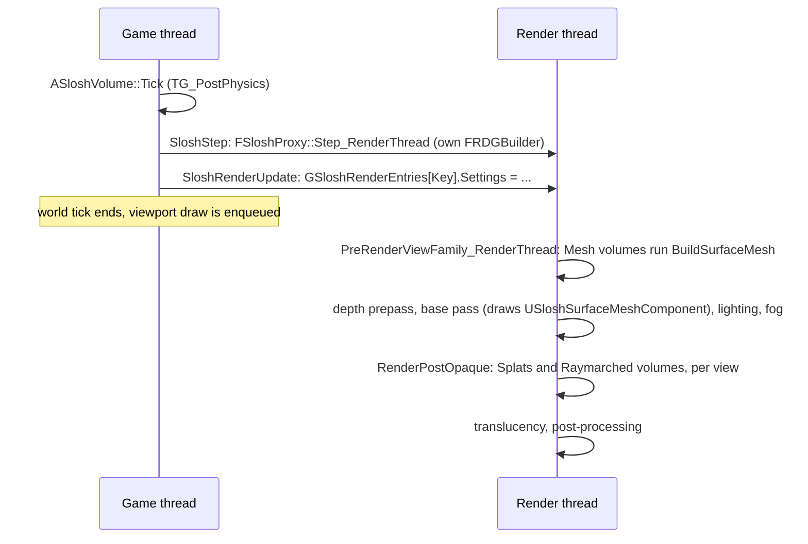
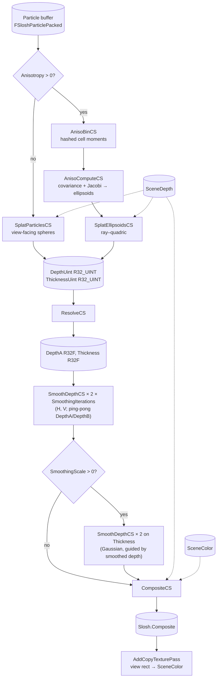
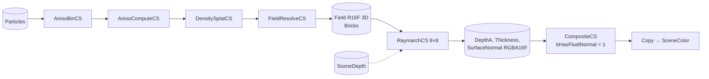
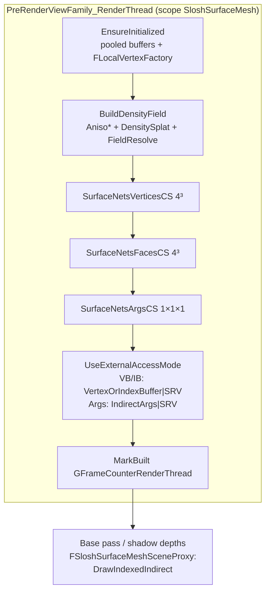

# Rendering

This page covers the liquid renderer in the `SloshRender` module and its game-side wiring in `Slosh`. Read it
before you change a pass, add a visual parameter or debug how the liquid looks. Everything here was checked against
the code. Where the background design doc (`Research/RENDERING_ARCHITECTURE.md`) disagrees with the code, the code
wins.

Related pages: [Architecture](Architecture.md) (module layout), [Simulation](Simulation.md) (the particle buffer the
renderer reads), [Materials](Materials.md) (liquid material assets), [Reference](Reference.md) (every property),
[Testing](Testing.md) (test flags and screenshots), [Troubleshooting](Troubleshooting.md).

---

## 1. Files

| File | Contents |
|---|---|
| `Source/SloshRender/Public/SloshRenderer.h` | `ESloshSurfaceRenderMode`, `FSloshRenderSettings` (render-thread copy of all visual settings), the `SloshRender::` API |
| `Source/SloshRender/Private/SloshRenderer.cpp` | Shader registration, render-entry registry, every pass graph, the post-opaque callback and the scene view extension |
| `Source/SloshRender/Private/SloshRenderShaders.h` | Parameter structs of the screen-space shaders (`SloshRender.usf`) |
| `Source/SloshRender/Private/SloshSurfaceShaders.h` | Parameter structs of the field, raymarch and surface-nets shaders (`SloshSurface.usf`) |
| `Source/SloshRender/Public/SloshSurfaceMesh.h`, `Private/SloshSurfaceMesh.cpp` | `FSloshSurfaceMeshBuffers`: the GPU-written mesh shared by the renderer and the mesh component |
| `Shaders/Private/SloshRender.usf` | Splats, anisotropy, resolve, smoothing, composite |
| `Shaders/Private/SloshSurface.usf` | Density field, raymarch, surface nets |
| `Shaders/Private/SloshCommon.ush` | `FSloshParticlePacked`, `LinearThreadId`, `IsDeadParticleAge`, `SLOSH_THREADS` (128) |
| `Source/Slosh/Public/SloshSurfaceMeshComponent.h`, `Private/SloshSurfaceMeshComponent.cpp` | `USloshSurfaceMeshComponent` and its scene proxy (Mesh mode) |
| `Source/Slosh/Public/SloshMaterialAsset.h` | `FSloshVisualProperties` (the user-facing look settings) |
| `Source/Slosh/Private/SloshVolume.cpp` | `ASloshVolume::UpdateRenderRegistration`, `GetEffectiveSurfaceMaterial` |
| `Source/Slosh/Private/SloshSubsystem.cpp` | `USloshRenderEngineSubsystem`, which starts and stops the renderer |

The virtual shader path `/Plugin/Slosh` → `Plugins/Slosh/Shaders` is registered by `SloshCore`
(`SloshCoreModule.cpp`). `SloshRender` depends on `SloshCore` and loads at `PostConfigInit`, so global shaders compile
at startup. Every shader derives from `FSloshRenderShaderBase` and compiles only on SM5-capable platforms.

The renderer only **reads** simulation output: the proxy's particle buffer, cell size, grid size and sim-to-world
transform. It never writes simulation state.

---

## 2. Engine integration

### 2.1 Startup

`USloshRenderEngineSubsystem` (a `UEngineSubsystem`) calls `SloshRender::Startup()` in `Initialize` and
`SloshRender::Shutdown()` in `Deinitialize`. `Startup()` runs on the game thread, can be called more than once, and
installs two hooks:

| Hook | Registered with | Used by | Runs |
|---|---|---|---|
| `RenderPostOpaque(FPostOpaqueRenderParameters&)` | `GetRendererModule().RegisterPostOpaqueRenderDelegate` | Splats and Raymarched | Once per view, after opaque lighting and fog, **before translucency** |
| `FSloshSceneViewExtension::PreRenderViewFamily_RenderThread` | `FSceneViewExtensions::NewExtension<>` | Mesh | Once per view family, before the scene renders (so before the base pass draws the mesh) |

`Shutdown()` removes the delegate, drops the view extension and clears the registry on the render thread.

### 2.2 The render-entry registry

```cpp
struct FSloshRenderEntry            // SloshRenderer.cpp, anonymous namespace
{
    const FSloshProxy*    Key;      // identity (raw pointer)
    FSloshProxyWeakPtr    Proxy;    // weak: a dead proxy drops its entry
    FSceneInterface*      Scene;    // only views of this scene draw the volume
    FSloshRenderSettings  Settings; // full copy, refreshed every frame
};
TArray<FSloshRenderEntry> GSloshRenderEntries;   // render thread only
```

- `SloshRender::AddOrUpdateVolume_GameThread(Proxy, Scene, Settings)` enqueues `SloshRenderUpdate`. On the render
  thread it finds the entry by `Key` (or adds one) and overwrites `Proxy`, `Scene` and `Settings`.
- `ASloshVolume` calls it from `BeginPlay` and **at the end of every `Tick`** (`UpdateRenderRegistration`). Visual edits
  made while playing therefore apply on the next frame. There is no dirty tracking: the whole settings struct is copied
  into a render command every frame.
- `SloshRender::RemoveVolume_GameThread(Proxy)` is called from `ASloshVolume::EndPlay`.
- `RenderPostOpaque` also removes entries whose weak proxy no longer resolves.
- The proxy only exists between `BeginPlay` and `EndPlay`. **Nothing renders in an editor viewport outside PIE or a
  game**.

### 2.3 Where it sits in a frame



The simulation step for frame N is enqueued before frame N's scene render, so the renderer always draws this frame's
particles.

### 2.4 Filtering in `RenderPostOpaque`

`RenderPostOpaque` returns early when the registry is empty or when the graph builder, colour, depth or view is
missing. It also returns early when `ColorTexture->Desc.NumSamples > 1`, so **forward shading with MSAA draws no
Splats or Raymarched liquid**. Mesh mode is an ordinary primitive and does not go through this check.

For each entry, iterated from last to first, it skips volumes that:
- are disabled (`bRenderLiquid` false), or
- are in Mesh mode, or
- belong to a different `FSceneInterface` from the view's family, or
- have no particles or no particle buffer.

The remaining volumes go to `RenderVolume`.

`Params.View` is an opaque `FViewInfo*`, which the code reinterprets as `const FSceneView*`. This relies on
`FViewInfo`'s only base being `FSceneView`, a private engine layout tracked as risk R-13 in `Research/RISK_REGISTER.md`.
The code reads `View.ViewMatrices` (pre-view translation, translated view matrix and its inverse),
`View.InvDeviceZToWorldZTransform` and `View.Family->Scene` from it.

### 2.5 Spaces and units

| Space | Units | Notes |
|---|---|---|
| Sim | metres, origin at the domain's min corner | `ASloshVolume::GetSimToWorld()` = scale 100, translate `-DomainSize/2` (cm), then actor rotation and location. Actor scale is ignored. |
| Translated world | cm | `SimToWorld * FTranslationMatrix(PreViewTranslation)`, composed in **double** before the cast to `FMatrix44f` |
| View | cm, +Z forward | `SimToView = SimToTranslatedWorld * TranslatedViewMatrix`. All screen-space depths and thicknesses are linear view Z in cm. |
| Voxel (field) | voxels | `sim metres * InvVoxelSize`. Voxel `v` covers `[v, v+1)` and its centre is at `v + 0.5`. |
| Volume-local | cm | Mesh vertices: `voxel * VoxelSizeCm + LocalOffsetCm`, with `LocalOffsetCm = -DomainSize/2` |

Scene depth goes from device Z to view Z with `DeviceZToViewZ`, which uses `InvDeviceZToWorldZTransform` and is
duplicated in both `.usf` files. `ParticleViewRadius = CellSize_m * SimToWorld.Scale.X (=100) * ParticleRadiusScale`,
which gives the splat radius in cm.

---

## 3. From settings to the render thread

`ASloshVolume::UpdateRenderRegistration` builds an `FSloshRenderSettings` from `GetVisual()` and the volume's own
properties. `GetVisual()` returns `Material->Visual` when a `USloshMaterialAsset` (or a paint preset) is assigned,
otherwise the inline `Visual`. Clamps are applied in `SloshRenderer.cpp`, not in the struct:

| `FSloshRenderSettings` | Source | Render-side clamp / use |
|---|---|---|
| `bEnabled` | `ASloshVolume::bRenderLiquid` | entry skipped when false |
| `SurfaceMode` | `ASloshVolume::SurfaceMode` (`Splats`→`Splats`, `Raymarched`→`Raymarch`, `Mesh`→`Mesh`) | |
| `AbsorptionPerMeter`, `ScatterColor`, `RefractionStrength`, `FresnelF0`, `SpecularPower` | `FSloshVisualProperties` | composite only |
| `ParticleRadiusScale` | visual | splat radius, field particle radius |
| `SmoothingRadius` | visual | clamp [0, 32] px. 0 disables all smoothing. |
| `SmoothingScale` | visual | > 0 switches on adaptive smoothing |
| `SmoothingIterations` | visual | clamp [1, 4] |
| `EdgeFadeThickness`, `ScatterLighting` | visual | `ScatterLighting` clamp [0, 1] |
| `Anisotropy`, `AnisotropyMaxStretch`, `AnisotropySmoothing` | visual | [0, 1], [1, 8], [0, 1] |
| `FieldResolution`, `SurfaceSmoothing`, `IsoLevel` | volume `FieldResolution`, `SurfaceSmoothing`, `SurfaceIsoLevel` | [0.5, 3], [0.5, 6], [0.02, 0.98] |
| `SkyZenithColor`, `SkyHorizonColor` | volume | composite reflection gradient |
| `LightDirectionWorld`, `LightColor` | `SunLight`: the first `ADirectionalLight` found if unset (written back into the property) | colour = `LightColor * min(Intensity, 10) * 0.5`. Without a light: direction (0.3, 0.2, −0.9), colour (3, 2.9, 2.7). |
| `LocalOffsetCm` | `-GetDomainSize()/2` | Mesh mode |
| `MeshBuffers` | `ASloshVolume::SurfaceMeshBuffers` | Mesh mode only |

Hard-coded constants: `SplatGroupSize = 128`, `MaxSplatPixels = 32`, `AnisoMinNeighbours = 35`,
`MaxFootprint = 4` voxels, raymarch `MaxSteps = 768`.

---

## 4. Surface modes

`ASloshVolume::SurfaceMode` (`ESloshSurfaceMode`) selects one of three pipelines:

| Mode | Hook | Surface from | Shading | Uses `Smoothing*` | Uses `FieldResolution`/`SurfaceSmoothing`/`SurfaceIsoLevel` |
|---|---|---|---|---|---|
| **Splats** (default) | post-opaque | per-particle sphere or ellipsoid splats → screen depth → bilateral smoothing | Slosh composite | yes | no |
| **Raymarched** | post-opaque | density field → per-pixel ray march | Slosh composite with field normals | no | yes |
| **Mesh** | view extension + base pass | density field → surface nets → triangle mesh | any UE material, with engine lighting and shadows | no | yes |

`Anisotropy`, `AnisotropyMaxStretch`, `AnisotropySmoothing` and `ParticleRadiusScale` apply to all three modes, because
the field is built from the same per-particle ellipsoids. Absorption, scatter, refraction, Fresnel, specular, edge fade,
scatter lighting and the sky colours do nothing in Mesh mode, where the UE material does the shading.

---

## 5. Splats pipeline

### 5.1 Pass graph



RDG event names, under the `SloshRender` GPU stat scope: `AnisoBin`, `AnisoCompute`, `SplatEllipsoids(N)` or
`SplatParticles(N)`, `Resolve`, `SmoothSurface` (one per direction and iteration, plus two for thickness), `Composite`,
then the copy.

### 5.2 Transient resources (per view, per volume)

All 2D targets have the **scene colour extent** (the full buffer, not the view rect). Each pass works inside
`ViewRectMin .. ViewRectMin + ViewSize`.

| RDG name | Format | Init | Meaning |
|---|---|---|---|
| `Slosh.DepthUint` | `PF_R32_UINT` | `0xFFFFFFFF` | `asuint` of the nearest positive view Z. `InterlockedMin` on the bits of a positive float orders the same as on the float. |
| `Slosh.ThicknessUint` | `PF_R32_UINT` | 0 | Accumulated chord length × `THICKNESS_FIXED_SCALE` (16, i.e. 1/16 cm) |
| `Slosh.DepthA` / `Slosh.DepthB` | `PF_R32_FLOAT` | — | Resolved view depth, ping-ponged by the smoother. `NO_FLUID_DEPTH = 3e38` marks empty pixels. |
| `Slosh.Thickness` | `PF_R32_FLOAT` | — | Thickness in cm |
| `Slosh.ThicknessTmp` | `PF_R32_FLOAT` | — | Adaptive mode only (thickness blur ping-pong) |
| `Slosh.NoNormal` | `PF_FloatRGBA` 1×1 | (0, 0, −1, 0) | Dummy normal input (`bHasFluidNormal = 0`) |
| `Slosh.Composite` | scene colour format | — | Composite output, copied back to SceneColor |
| `Slosh.AnisoKeys` | `uint` × `TableSize` | `0xFFFFFFFF` | Open-addressed cell hash keys |
| `Slosh.AnisoMoments` | `uint` × `TableSize × 10` | 0 | Fixed-point cell moments |
| `Slosh.Ellipsoids` | `float4` × `4 × NumParticles` | — | centre, axis0, axis1, axis2 (sim metres) |

`TableSize = clamp(RoundUpToPowerOfTwo(2 × NumParticles), 4096, 2^22)`, so the table is at most half full.

### 5.3 `SplatParticlesCS` (sphere splats)

There is one thread per particle (`[numthreads(128,1,1)]`, rows of groups through `LinearThreadId` /
`Slosh::GroupCount1D`). Each thread:

1. Returns if `IsDeadParticleAge(Age)` (`!(Age >= 0)`).
2. Transforms the position to view space and rejects it if `Vp.z < ParticleViewRadius + 1` (near plane).
3. Projects it and computes `RadiusPx = r · P[0][0] · 0.5 · ViewSize.x / z`, clamped to `MaxSplatPixels` (32).
4. For each pixel of the bounding square inside the disc (`q² = d²/R² ≤ 1`):
   - computes the sphere front `Depth = z − r·sqrt(1 − q²)`;
   - rejects the pixel if it is behind the scene depth;
   - `InterlockedMin(FluidDepthUint, asuint(Depth))`;
   - `InterlockedAdd(FluidThicknessUint, uint(min(2·Dz, SceneZ − Depth) · 16))`.

Thickness is the **sum of every overlapping particle's chord**, clipped at the scene. It is not the true depth range
of the liquid along the ray (the standard SSFR approximation, van der Laan et al. 2009).

The clamp to 32 px changes only the footprint. The depth profile still uses the full radius, so very close
particles become smaller discs with gaps between them.

### 5.4 Anisotropic ellipsoids (Yu & Turk 2013)

These passes run when `Anisotropy > 0` in Splats mode, and **always** in Raymarched and Mesh modes, which build the
field from ellipsoids (see §10).

**`AnisoBinCS`.** There is one thread per live particle.
- The cell is `C = floor(Pos / BinSize)` with `BinSize = CellSize` (sim metres), and its key packs `clamp(C, 0, 1023)`
  into 10 bits per axis.
- The thread hashes the key (a 32-bit integer mix), then inserts it with linear probing (`InterlockedCompareExchange`,
  at most `ANISO_MAX_PROBES = 32` probes). A particle that finds no slot contributes no moments.
- With the in-cell offset `Q = saturate(G − C) · 1023`, the thread atomically adds 10 moments to the slot:
  - `count`;
  - `ΣQx`, `ΣQy`, `ΣQz`;
  - `ΣQx²`, `ΣQy²`, `ΣQz²`;
  - `ΣQxQy`, `ΣQxQz`, `ΣQyQz`.

**`AnisoComputeCS`.** There is one thread per particle.
- A dead particle writes four zero vectors, the "zero-size ellipsoid" that every later pass skips.
- A live particle gathers the 3×3×3 neighbouring cells with separable tent weights centred on the particle:
  `Tent = max(1.5 − |D + 0.5 − Off|, 0)` per axis, a radius of 1.5 cells. It shifts each cell's moments by the cell's
  corner offset `D` to form the weighted mean and covariance in cell units.
- If the weighted count `W ≥ AnisoMinNeighbours` (35) and `AnisoStrength > 0`:
  1. `JacobiEigen3` runs 5 cyclic Jacobi sweeps on the symmetric 3×3 covariance and returns the eigenvalues `E` and the
     eigenvector columns `V`.
  2. `E = max(E, 0)`, then `E = max(E, Emax / MaxStretch²)`, so no axis ratio exceeds `AnisotropyMaxStretch`.
  3. `S = sqrt(E)`, normalised by its geometric mean (product 1, which preserves volume), then raised to the power
     `AnisoStrength`.
  4. `Axis_k = V[:,k] · SplatRadiusSim · S_k`, with `SplatRadiusSim = CellSize · ParticleRadiusScale`.
  5. Smoothing of the position: `Center = lerp(Pos, neighbourhood mean, AnisotropySmoothing)`.
- Otherwise the particle stays a sphere of radius `SplatRadiusSim` at `Pos`. A full interior neighbourhood weighs about
  125 at 8 particles per cell, so the threshold of 35 keeps spray and falling columns round instead of stretching
  them into rods.

**`SplatEllipsoidsCS`.** There is one thread per ellipsoid.
1. It skips zero axes, then moves the centre and axes to view space.
2. It solves `(p − c)ᵀQ(p − c) = 1` with `W_k = u_k / |u_k|²` for a view ray of `z = 1`, using the bounding radius
   `max|u_k|` for the pixel footprint (clamped to 32 px).
3. Each pixel takes the nearer root as its view depth. The chord `2·sqrt(disc)/Aq · |ray|` is its thickness. Both are
   written to the same uint targets as the spheres, with the same scene-depth rejection.

Effect: films flatten into discs and streams into rods, so thin liquid reads as a sheet instead of a string of beads.

### 5.5 `ResolveCS`

It converts the uint targets to `DepthA` (or `3e38` where nothing was written) and to `Thickness / 16` in cm.

### 5.6 `SmoothDepthCS`: separable bilateral filter

The C++ lambda `AddSmooth(In, Guide, Out, Direction, Falloff)` dispatches one 1D pass. With
`MaxRadius = clamp(SmoothingRadius, 0, 32)`:

```
if MaxRadius > 0:
    repeat clamp(SmoothingIterations,1,4):
        AddSmooth(Src, Src, Dst, (1,0), max(2·ParticleViewRadius, 0.1));  swap
        AddSmooth(Src, Src, Dst, (0,1), ...);                              swap
    if SmoothingScale > 0:                       // adaptive only
        AddSmooth(Thickness, Src, ThicknessTmp, (1,0), 0)    // Falloff 0 = plain Gaussian
        AddSmooth(ThicknessTmp, Src, Thickness, (0,1), 0)
```

The kernel, per output pixel:
- A pixel whose guide depth is `NO_FLUID_DEPTH` passes through unchanged. Background taps are skipped, so the filter
  never pulls liquid depth toward the background.
- `Sigma = max(Radius/2, 0.5)`, spatial weight `exp(−o²/2σ²)`.
- Range weight (when `DepthFalloff > 0`): `exp(−((Z − Zc − Slope·o) / DepthFalloff)²)`. The tap value is also
  corrected by `−Slope·o`.

The two smoothing modes:

| | Classic (`SmoothingScale == 0`, default) | Adaptive (`SmoothingScale > 0`) |
|---|---|---|
| Radius | Fixed `SmoothingRadius` pixels at every distance | `clamp(round(RadiusPerViewZ / z), 1, SmoothingRadius)`, with `RadiusPerViewZ = SmoothingScale · ParticleViewRadius · P[0][0] · 0.5 · ViewSize.x`. The footprint is a constant number of splat radii in world space, and `SmoothingRadius` becomes the cap that close-ups hit. |
| Range weight | Flat depth difference, `DepthFalloff = 2 × splat radius` (cm) | Slope-aware (`bSlopeAware = 1`): fits a local slope from the guide at ±2 px, `Slope = (Zp − Zm)/4`, only when the neighbourhood is monotone and `|Slope| ≤ 4·DepthFalloff`. Taps are compared against that plane. |
| Thickness | Not filtered | Gaussian blur in the same footprint, guided by the smoothed depth |
| Look | Keeps water's fine ripples | Smooth, viscous. Removes grazing-angle stair-step streaks. |

Why slope-aware: on a surface seen at a grazing angle, view depth changes by more than `DepthFalloff` per pixel. A
flat-depth bilateral then refuses to smooth across rows of splats, and the stair steps survive as streaks of wrong
normals (sky reflections). Peaks and valleys (bumps, silhouettes) give zero slope, so real edges still stop the filter.

### 5.7 `CompositeCS`

There is one thread per view-rect pixel. Pixels with no liquid copy the scene colour.

1. **Normal.**
   - `bHasFluidNormal == 0` (Splats): the normal comes from the smoothed depth. For each axis the smaller of the
     one-sided differences is used, so it does not smear across silhouettes. `N = normalize(cross(ddy, ddx))`.
   - `bHasFluidNormal == 1` (Raymarched): the normal is read from `FluidNormal`.
   - In both cases the normal is flipped to face the camera.
2. **Fresnel.** Schlick: `F = F0 + (1 − F0)(1 − N·V)⁵`.
3. **Refraction.**
   - The scene colour lookup is offset by `N.xy · (1, −1) · RefractionStrength · min(Thickness, 50) / z · ViewSize.x`
     pixels.
   - If the scene at the offset pixel is in front of the liquid, the unrefracted pixel is used instead.
4. **Absorption** (Beer–Lambert): `T = exp(−AbsorptionPerMeter · Thickness_cm · 0.01)`.
5. **Scatter.**
   - `ScatterLit = ScatterColor · lerp(1, 0.4 + 0.6·wrap², ScatterLighting)`, with
     `wrap = saturate(N·(−L) · 0.5 + 0.5)`.
   - `Refracted = Behind · T + ScatterLit · (1 − T)`.
   - `ScatterLighting = 0` gives flat scatter (the classic look). At 1, thick, opaque liquids keep visible shape.
6. **Reflection.**
   - The sky term blends `SkyHorizonColor → SkyZenithColor` by the world-space Z of the reflected vector
     (`ViewToWorld`).
   - Specular: `LightColor · saturate(R·(−L))^SpecularPower`, a Phong lobe around the reflection vector.
7. **Result.** `Color = lerp(Refracted, Sky, F) + Spec · F`.
8. **Coverage.**
   - `Coverage = EdgeFadeThickness > 0 ? smoothstep(0, EdgeFadeThickness, Thickness) : 1`.
   - Output `lerp(Scene, Color, Coverage)`, with the scene alpha kept.

The final `AddCopyTexturePass` copies only the view rect back into `SceneColor`.

---

## 6. The surface field (Raymarched and Mesh)

`BuildDensityField` in `SloshRenderer.cpp` builds a voxel field over the **whole simulation domain**. Its inputs are the
per-particle ellipsoids from §5.4, run with `Strength = Anisotropy`.

```
Resolution  = clamp(FieldResolution, 0.5, 3)
VoxelMeters = CellSize / Resolution
FieldDim    = ceil(GridDim × Resolution)
BrickDim    = ceil(FieldDim / 8)
```

| RDG name | Format | Notes |
|---|---|---|
| `Slosh.FieldAccum` | `int32 × 5 × voxels`, cleared to 0 | Fixed-point moments: Σw (×1024), Σw·offset xyz (×256), Σw·r (×256) |
| `Slosh.Field` | 3D `PF_R16F`, SRV + UAV | `F ∈ [0, 1]`, sampled trilinear, clamped |
| `Slosh.FieldBricks` | `uint × bricks`, cleared to 0 | 8³ brick occupancy for empty-space skipping |

### 6.1 `DensitySplatCS`: the Zhu & Bridson (2005) particle surface

The field is not a density threshold. Each voxel stores what it needs to evaluate

```
φ(x) = |x − x̄(x)| − r̄(x)
x̄ = Σ wᵢ xᵢ / Σ wᵢ,   r̄ = Σ wᵢ rᵢ / Σ wᵢ
wᵢ = (1 − q²)³,       q² = |Wᵀ(x − cᵢ)|²
```

The kernel is anisotropic: the ellipsoid's axes scaled by `SupportScale = clamp(SurfaceSmoothing, 0.5, 6)`.

There is one thread per particle; zero-size (dead) ellipsoids are skipped. Each thread loops over the voxels in
`centre ± R`, where `R = min(longest axis in voxels, MaxFootprint = 4)`. For each voxel with `q² < 1` it atomically
adds:
- `w`;
- `w·(cᵢ − x)` (the particle offset seen from the voxel centre);
- `w·ParticleRadiusVoxels`, with `ParticleRadiusVoxels = ParticleRadiusScale × Resolution`. This radius is isotropic.

Why this field: every particle gets a surface at least its own radius thick. Stretched streams, thin coats and drips
stay visible, while dense liquid still merges into one smooth surface.

### 6.2 `FieldResolveCS`

`[numthreads(4,4,4)]`, one thread per voxel:

```
W = Σw;  if W ≤ 1e-3: F = 0
else:    φ = |Σw·offset / W| − r̄;   F = saturate(0.5 − 0.5·φ / r̄)
```

`F` is 1 deep inside (where `x̄ ≈ x` and `φ ≈ −r̄`), 0.5 at the particle radius, and 0 at `φ ≥ r̄` or outside every
kernel. **`IsoLevel = 0.5` puts the surface exactly at the particle radius.** `F = IsoLevel` means
`φ = r̄·(1 − 2·IsoLevel)`, so each 0.1 of iso level moves the surface by 0.2 particle radii.

Brick occupancy: a voxel with `F > 0` sets its own brick's flag with `InterlockedOr`. If it lies on a brick face, edge
or corner, it also sets the neighbouring bricks on that side (up to 8 in all). Trilinear interpolation, and
surface-nets cells that straddle bricks, can put the surface into the neighbour.

### 6.3 Field parameters and their sensitivity

| Setting | Default | Range | Effect |
|---|---|---|---|
| `FieldResolution` | 1.0 | 0.5–3 | Voxels per solver cell. 2× resolution = 8× voxels, memory and splat cost. Detail is still limited by the particle spacing (2 per cell). |
| `SurfaceSmoothing` | 2.0 | 0.5–6 | Kernel support in splat radii. Larger = rounder, more merged, less detail. Raises `DensitySplatCS` cost roughly with the cube of the support. |
| `SurfaceIsoLevel` | 0.5 | 0.05–0.95 (0.02–0.98 render clamp) | **Sensitive.** Lower = fatter, more connected. Higher = thinner, beadier. Below ~0.3 the surface moves out toward the edge of the kernel support, where `W` is small and `x̄` is noisy. If it passes the support edge, `F` drops abruptly to 0 and the surface turns lumpy or faceted. Change it in steps of 0.05. |

---

## 7. Raymarched pipeline



There is no resolve and no smoothing. If the field cannot be built (no particles, degenerate grid), the outputs are
cleared to `3e38` / 0 / (0, 0, −1) instead.

**`RaymarchCS`** (`[numthreads(8,8,1)]`, one thread per pixel):

1. Builds the view ray with `z = 1`, transforms it with `ViewToSim` to voxel space as `P(t) = O + D·t`, where `t` is
   view depth in cm.
2. Clips it to the field box (slab test), starting at `t ≥ 1`, and ends it at the scene depth.
3. Marches in **half-voxel steps** (`Step = 0.5 / |D|`), at most `MaxSteps = 768`:
   - If the current brick is unoccupied, it jumps to that brick's exit plane (plus a small epsilon, and at least a
     quarter step).
   - If `SampleField(P) ≥ IsoLevel`, it has a hit.
4. Refines the crossing between the last outside sample and the first inside one with **6 bisection steps**.
5. **Thickness**: walks on in one-voxel steps (at most 96) until the field drops below `IsoLevel` or reaches the scene.
   `Thickness = (t_exit − t_hit) · |ray|`. Only the first liquid interval is counted.
6. **Normal**: the central-difference gradient (±1 voxel) of the trilinear field, `−∇F` moved to view space and flipped
   toward the camera.
7. Writes `DepthOut = t_hit`, `ThicknessOut`, `NormalOut = (N, 1)`.

The composite then runs as in §5.7 with `bHasFluidNormal = 1`.

---

## 8. Mesh pipeline

### 8.1 Pass graph



`BuildSurfaceMesh` runs **at most once per render frame** per volume, guarded by
`GetLastBuiltFrame() == GFrameCounterRenderThread`, even when several view families render that frame. If the field
cannot be built, the vertex and face passes are skipped and `SurfaceNetsArgsCS` writes a zero index count.

### 8.2 Surface nets kernels (`SloshSurface.usf`)

Transient buffers: `Slosh.SurfaceCounters` (2 × uint: [0] vertices, [1] indices, cleared each build) and
`Slosh.SurfaceCellVertex` (one uint per cell, `CellDim = FieldDim − 1`).

**`SurfaceNetsVerticesCS`.** There is one thread per cell.
1. It sets `CellVertex = 0xFFFFFFFF` and returns if the cell's brick is empty.
2. It loads the 8 corner values with `Field.Load` and builds an 8-bit inside mask (`F ≥ IsoLevel`). An all-in or
   all-out cell returns.
3. The vertex position is the **mean of the crossings on the cell's 12 edges**, each found by linear interpolation.
4. It takes an index with `InterlockedAdd(Counters[0])` and drops the vertex if the index is `≥ MaxVertices`.
5. It writes:
   - `Position = (C + 0.5 + mean) · VoxelSizeCm + LocalOffsetCm` (volume-local cm);
   - `TangentZ = −normalize(∇F)` and an arbitrary orthogonal `TangentX` (`float4(N, 1)`, `float4(TX, 0)`);
   - `TexCoord0 = 0.01 · (x + z, y + z)`, a planar projection of local cm.

**`SurfaceNetsFacesCS`.** There is one thread per cell, in an occupied brick.
- For each of the three positive edges from voxel `C` to `C + e_axis` whose inside flag changes, it gathers the four
  cells around that edge: `C`, `C − e_u`, `C − e_v`, `C − e_u − e_v`.
- If all four have vertices, it reserves 6 indices with `InterlockedAdd(Counters[1], 6)` (dropped past `MaxIndices`)
  and writes two triangles. The winding faces away from the inside voxel.

**`SurfaceNetsArgsCS`.** One thread writes `DrawIndexedInstanced` args:
`{ min(count, MaxIndices) rounded down to a multiple of 3, 1, 0, 0, 0 }`.

When either budget is exceeded, surface beyond it is silently dropped: missing vertices make their faces skip, so
holes appear. Raise `MaxSurfaceVertices` if large bodies of liquid show holes.

### 8.3 `FSloshSurfaceMeshBuffers`

The class is created on the game thread with `FSloshSurfaceMeshBuffers::Create(MaxVertices)`, which clamps the budget
to [1024, 8 Mi]. Every method is render-thread only.

| Buffer | RDG desc | Bound as |
|---|---|---|
| `Positions` (`Slosh.SurfacePositions`) | `float × 3·MaxV` | typed UAV `PF_R32_FLOAT`; VB `VET_Float3`; SRV `PF_R32_FLOAT` |
| `Tangents` (`Slosh.SurfaceTangents`) | `uint32 × 2·MaxV` | UAV `PF_R8G8B8A8_SNORM`; two `VET_PackedNormal` streams (TangentX, TangentZ, stride 8); SRV RGBA8 SNORM |
| `TexCoords` (`Slosh.SurfaceTexCoords`) | `FVector2f × MaxV` | UAV `PF_G32R32F`; one UV channel `VET_Float2` |
| `Indices` (`Slosh.SurfaceIndices`) | `uint32 × 6·MaxV` | UAV `PF_R32_UINT`; 32-bit index buffer |
| `Args` (`Slosh.SurfaceArgs`) | `CreateIndirectDesc<FRHIDrawIndexedIndirectParameters>(1)` | UAV `PF_R32_UINT`; indirect args |

- **Pooled buffers.** The buffers are `TRefCountPtr<FRDGPooledBuffer>` from `AllocatePooledBuffer`. They persist across
  frames and are registered into each frame's graph with `RegisterExternalBuffer`.
- **Engine wrappers.** `FSloshExternalVertexBuffer` and `FSloshExternalIndexBuffer` expose the pooled RHI buffers as
  `FVertexBuffer`/`FIndexBuffer`, so an `FLocalVertexFactory` ("SloshSurfaceMesh") can bind them. Its colour stream is
  bound to the default colour buffer. Every UE surface material works, including manual vertex fetch through the
  typed SRVs.
- **Lazy creation.** `EnsureInitialized` allocates everything the first time `BuildSurfaceMesh` runs. Until then
  `HasMesh()` is false and the proxy draws nothing.
- **Hand-off to the base pass.** `UseExternalAccessMode` leaves the buffers in read-only states after the graph runs,
  because mesh draw commands read them outside RDG.
- **Deferred deletion.** The shared pointer's custom deleter deletes the object immediately on the render thread, and
  otherwise enqueues `SloshDeleteSurfaceMesh`. The last reference can therefore drop on any thread.
  `ReleaseRenderResources` releases the vertex factory, the wrappers and the pooled buffers.

Persistent memory: (12 + 8 + 8 + 24) B ≈ **52 B per budgeted vertex**. The default `MaxSurfaceVertices` of
1,000,000 is about 52 MB per Mesh-mode volume.

### 8.4 `USloshSurfaceMeshComponent` and its proxy

`ASloshVolume::UpdateRenderRegistration` manages the component when `SurfaceMode == Mesh` and `bRenderLiquid`:
- It (re)creates `SurfaceMeshBuffers` when the clamped `MaxSurfaceVertices` changes.
- It creates the transient component `SloshSurfaceMesh` the first time, attached to the `Bounds` root.
- It calls `Configure(Buffers, DomainSize/2, GetEffectiveSurfaceMaterial())`, which marks the render state dirty only
  when the buffers, the material or the extent changed.
- It passes the buffers to the render entry.

Switching away from Mesh mode destroys the component and releases the buffers.

`FSloshSurfaceMeshSceneProxy`:
- Bounds are the full domain box. `CanBeOccluded()` returns false.
- Relevance is dynamic. Shadow relevance follows `CastShadow` (true by default). `bVelocityRelevance = false`: no motion
  vectors.
- `GetDynamicMeshElements` emits one `FMeshBatch` per visible view: the local vertex factory, the 32-bit index buffer,
  `NumPrimitives = 0` and `IndirectArgsBuffer = Args`, so the GPU-built index count drives the draw. A
  `FDynamicPrimitiveUniformBuffer` is built per batch.
- Without a material it falls back to `UMaterial::GetDefaultMaterial(MD_Surface)`.

**Material selection** (`ASloshVolume::GetEffectiveSurfaceMaterial`):
1. `SurfaceMaterial`, if set.
2. Otherwise, if `Material` is a `USloshPaintPreset`, that preset's paint material (`Preset->Material`). See
   [SloshPaint.md](SloshPaint.md#9-presets-are-also-liquid-materials).
3. Otherwise null, which draws with the engine default material.

The mesh only provides `TexCoord0 = 0.01·(x+z, y+z)`. Fluid Painter preset materials expect
`UV0 = (fading, arc length)` and object coordinates in UV1/UV2 (see [SloshPaint.md](SloshPaint.md#5-meshing-pipeline)),
so their fading ramp and object-space noise do not match the painted look on a Mesh-mode volume. Base colour,
roughness and transmission still carry over.

---

## 9. Dead (drained) particles

Drains and other removal mark a particle dead with `Age < 0` (`IsDeadParticleAge(Age) = !(Age >= 0)`, which also
treats NaN as dead). The dispatch size is the proxy's CPU upper bound `NumParticles`, so dead slots are present in the
buffer and every pass must skip them:

| Pass | How |
|---|---|
| `SplatParticlesCS`, `AnisoBinCS` | Early return on `IsDeadParticleAge` |
| `AnisoComputeCS` | Writes a zero-size ellipsoid (four zero vectors) |
| `SplatEllipsoidsCS`, `DensitySplatCS` | Return when `dot(axis0, axis0) ≤ 0` |
| `RaymarchCS`, surface nets | Read only the field, which contains no dead particles |

Any new pass that reads particles or ellipsoids must follow the same rule.

---

## 10. Performance

The research doc's measurement for the original sphere path is about **0.67 ms at 1280×720 with 262k particles**
(`Research/RENDERING_ARCHITECTURE.md` §3; splatting was 0.56 ms of that). Newer passes have not been measured to the
same standard. Use `stat gpu` (the `SloshRender` GPU stat) or `profilegpu` and look for the event names above.

- **Splat cost** scales with particles × projected pixel area. It rises as the camera approaches, until the 32 px clamp.
  Smoothing and the composite scale with pixels.
- **Everything screen-space runs per view, per volume.** Split-screen, stereo and multiple editor viewports multiply
  the cost. Anisotropy passes are not shared between views either.
- **Anisotropy** adds two particle passes. The gather probes up to 27 hash cells per particle; memory is about 44 B
  per table slot plus 64 B per particle (about 40 MB transient at 262k particles).
- **Field modes always run the anisotropy passes, even at `Anisotropy = 0`.** `AnisoComputeCS` performs the full
  27-cell gather and only then decides to emit a sphere. Skipping the gather when the strength is 0 is an easy saving.
- **The field covers the whole domain**, not only where liquid is. A 64×64×48 grid at resolution 1 is 196,608 voxels,
  about 4.3 MB transient (20 B accumulator + 2 B field per voxel). Resolution 2 is about 34 MB; resolution 3 is about
  117 MB.
- **`DensitySplatCS`** costs roughly particles × (kernel diameter in voxels)³, capped by `MaxFootprint`.
  `FieldResolution` and `SurfaceSmoothing` both enlarge the kernel.
- **Raymarch** cost depends on pixels × occupied bricks crossed. Empty bricks are skipped in one step.
- **Mesh mode** pays the field and surface nets once per frame (not per view), then a normal indexed draw per pass
  (base pass and each shadow view). Persistent buffers are about 52 B × `MaxSurfaceVertices`.
- **Game thread.** `UpdateRenderRegistration` runs every tick and enqueues one render command with the full settings
  copy. While no directional light exists, it also iterates actors looking for one every tick.

---

## 11. Known artifacts and limits

- **Composited before translucency, without writing depth.** Translucent objects draw over the liquid unsorted.
  Depth-based effects that run later (DOF, SSR) do not see the liquid. Height fog is already in the scene colour behind
  the liquid but is not applied to the liquid itself.
- **No motion vectors** in any mode, so TSR/TAA can smear fast flow. Mesh mode sets `bVelocityRelevance = false`.
- **Shadows.** Splats and Raymarched neither cast nor receive shadows; refraction shows scene shadows behind the liquid.
  Mesh mode casts and receives shadows through the engine. Its `CastShadow` is always true, regardless of a paint
  preset's `bCastShadows`.
- **Reflections** are an analytic sky gradient plus one directional specular lobe. No SSR, reflection captures or
  Lumen. Mesh mode gets whatever the UE material and engine provide.
- **Several volumes overlapping on screen** composite one after another against the scene depth only, not against
  each other's liquid depth. The volume processed last (the earliest registered, since the loop runs backwards) draws
  on top regardless of distance.
- **MSAA / forward shading**: Splats and Raymarched draw nothing (§2.4). **Mobile**: unsupported (SM5 shaders,
  post-opaque deferred textures).
- **Near-camera splats** are clamped to 32 px, which shows gaps up close, and particles within one splat radius of
  the near plane are dropped.
- **Thickness is approximate.** In Splats it is the sum of overlapping chords. Raymarched counts only the first liquid
  interval (at most 96 voxels).
- **Field kernel truncation.** `DensitySplatCS` clips the kernel's bounding box to `MaxFootprint = 4` voxels without
  rescaling the kernel. When `FieldResolution × SurfaceSmoothing × ParticleRadiusScale × stretch` exceeds 4, the
  kernel is cut to a cube and the surface turns boxy. Example: resolution 2 with defaults and full anisotropy stretch
  is about 6 voxels.
- **Anisotropy hash key** clamps cell coordinates to [0, 1023]. A domain with more than 1024 cells on an axis would
  alias. A crowded table can drop a particle's moments after 32 probes.
- **Actor scale.** The simulation and the screen-space modes ignore actor scale. The Mesh component is attached to the
  scaled root and does not, so a scaled `ASloshVolume` puts the mesh out of place.
- **Nothing renders outside PIE or game**, because the proxy is created in `BeginPlay`.
- **Classic smoothing** (`SmoothingScale = 0`) is fixed in pixels: distant liquid is over-smoothed and close liquid
  under-smoothed. That is the trade-off for keeping water's ripples. Adaptive smoothing fixes it at the cost of detail.

### Tried and rejected

An experiment added a blur of the density field plus temporal blending of the field between frames, to calm the
Raymarched and Mesh surfaces. It made the result worse and was **reverted**. Do not reintroduce it without a new
approach and side-by-side captures.

---

## 12. Tuning guide

### 12.1 What each setting does on screen

| Setting (`FSloshVisualProperties` unless noted) | Default | Visual effect |
|---|---|---|
| `AbsorptionPerMeter` (RGB) | (4.0, 1.2, 0.8) | Beer–Lambert absorption. Higher = darker and more saturated with depth. Absorbing red more gives water its blue-green tint. Opaque liquids need values in the hundreds. |
| `ScatterColor` | (0.02, 0.08, 0.10) | The colour thick liquid tends toward. It dominates once transmittance is low. |
| `RefractionStrength` | 0.02 | Size of the background distortion. It scales with thickness (capped at 50 cm) and falls off with distance. |
| `FresnelF0` | 0.02 | Reflectance at normal incidence. Water is about 0.02; glossy syrups use 0.04–0.05. |
| `SpecularPower` | 400 | Sharpness of the sun highlight. |
| `ParticleRadiusScale` | 0.6 | Splat radius in cells, and the field's particle radius. Larger = fewer gaps, blobbier; smaller = grainier. |
| `SmoothingRadius` | 7 | Classic: blur radius in pixels. Adaptive: cap on the radius. 0 turns all smoothing off. |
| `SmoothingScale` | 0 | 0 = classic fixed-pixel filter. > 0 = adaptive (radius in splat radii, slope-aware, thickness blur). Typical values 2–6. |
| `SmoothingIterations` | 1 | Repeats of the H+V pair. Each repeat flattens bumps further and costs two more full-screen passes. |
| `Anisotropy` | 0 | 0 = round splats. Toward 1, films become sheets and streams become rods. Also shapes the field in Raymarched and Mesh modes. |
| `AnisotropyMaxStretch` | 4 | Largest axis ratio. Higher = thinner sheets, with a risk of needle artifacts. |
| `AnisotropySmoothing` | 0.5 | Pulls each splat toward its neighbourhood centre: an evener surface, slightly shrunken edges. |
| `EdgeFadeThickness` (cm) | 0 | Liquid thinner than this fades into the scene. It hides lone particles and softens film edges; too high makes thin streams vanish. |
| `ScatterLighting` | 0 | 0 = flat scatter colour. 1 = wrapped-diffuse lit scatter, which gives opaque liquids readable shape. |
| `SkyZenithColor` / `SkyHorizonColor` (volume) | (0.25, 0.45, 0.9) / (0.75, 0.85, 1.0) | Colours of the reflection gradient. Match them to the level's sky. |
| `SunLight` (volume) | auto | Direction and colour of the specular highlight and the scatter lighting. |
| `SurfaceMode` (volume) | Splats | §4 |
| `FieldResolution`, `SurfaceSmoothing`, `SurfaceIsoLevel` (volume) | 1 / 2 / 0.5 | §6.3 |
| `SurfaceMaterial`, `MaxSurfaceVertices` (volume) | none / 1,000,000 | §8 |

### 12.2 The two reference looks

| | Classic water (struct defaults) | Viscous look (stored in every Fluid Painter preset) |
|---|---|---|
| `SmoothingRadius` | 7 | 24 |
| `SmoothingScale` | 0 | 4 |
| `SmoothingIterations` | 1 | 3 |
| `Anisotropy` | 0 | 0.85 |
| `EdgeFadeThickness` | 0 | 1.5 |
| `ScatterLighting` | 0 | 1 |
| `ParticleRadiusScale` | 0.6 | 0.9 |

The viscous values were briefly the struct defaults and over-smoothed water: ripples were lost, streaks appeared at the
walls and edges went ragged. Commit `ba7c1ec` restored the classic defaults and wrote the viscous values explicitly
into every `DA_SloshPaint_*` preset, so honey and the other presets keep their look.

### 12.3 Recipes

- **Water.** Keep the classic defaults. If thin sheets look beady, try `Anisotropy` 0.5–0.7 before touching smoothing.
- **Honey, syrup, slime.** Start from the viscous column, then set absorption and scatter for the colour. If the
  liquid looks like flat paint, raise `ScatterLighting`.
- **Stray droplets look like dots.** Raise `EdgeFadeThickness` to 0.5–1.5 cm.
- **Streaks at grazing angles.** Switch to adaptive smoothing (`SmoothingScale` > 0).
- **Surface too lumpy in Raymarched/Mesh.** Raise `SurfaceSmoothing` (2 → 3) before `FieldResolution`, and keep the
  product under the 4-voxel cap (§11).
- **Liquid looks thin or broken in Raymarched/Mesh.** Lower `SurfaceIsoLevel` by 0.05 at a time, or raise
  `ParticleRadiusScale`.

---

## 13. Changing the renderer

### Add a visual parameter

1. Add a `UPROPERTY` to `FSloshVisualProperties` (`SloshMaterialAsset.h`), or to `ASloshVolume` for per-volume
   settings.
2. Add a field with the same default to `FSloshRenderSettings` (`SloshRenderer.h`).
3. Copy it in `ASloshVolume::UpdateRenderRegistration`.
4. Add a `SHADER_PARAMETER` to the pass's `FParameters` in `SloshRenderShaders.h` or `SloshSurfaceShaders.h`, set it
   (clamped) in `SloshRenderer.cpp`, and declare the same name in the `.usf`. The `.usf` files declare parameters as
   loose globals shared by every entry point in the file.
5. If paint presets should carry it, update the preset assets too: they store full `Visual` structs.

### Add a pass

- Declare the shader class (deriving from `FSloshRenderShaderBase`) in the right header, add an
  `IMPLEMENT_GLOBAL_SHADER(..., SLOSH_RENDER_USF | SLOSH_SURFACE_USF, "EntryCS", SF_Compute)` line at the top of
  `SloshRenderer.cpp`, and add it to the graph in `RenderVolume`, `BuildDensityField` or `BuildSurfaceMesh`.
- Per-particle passes use 128-thread groups dispatched with `Slosh::GroupCount1D` and index through
  `LinearThreadId(DTid, SLOSH_THREADS)`. Dispatches wrap into rows to stay under 65,535 groups per dimension.
- Skip dead particles (§9). Use `NO_FLUID_DEPTH` (3e38) for empty depth. Keep thickness in cm and depth in linear view
  cm.
- Iterate on shaders with `r.ShaderDevelopmentMode 1` and `recompileshaders changed`.

### Things that are easy to break

- **Matrix precision.** Compose `SimToTranslatedWorld` in double before casting. Using world space directly loses
  precision far from the origin.
- **`InterlockedMin` on `asuint(depth)`** only orders correctly for positive floats. Keep the near-plane rejection.
- **Mesh buffer formats.** UAV formats, the vertex-factory stream layout and the SRV formats must agree:
  R32F×3, RGBA8 SNORM×2, RG32F, R32 uint.
- **Read-only hand-off.** `UseExternalAccessMode` must cover every buffer the base pass reads. Without it RDG leaves
  them in UAV state and the draw reads stale data or faults validation.
- **Frame guard.** Keep the once-per-frame guard (`MarkBuilt`) in Mesh mode. Rebuilding while another view family's
  draw commands still reference the buffers races.

---

## 14. Code notes worth knowing

- **Stale comment.** `SloshSurface.usf:5-6` says `FieldResolveCS` "normalises it by the rest density (interior ~= 1)".
  The code implements the Zhu–Bridson `φ` mapping described in §6.2.
- **Kernel truncation.** `SloshRenderer.cpp:143` sets `MaxFootprint = 4`, which truncates rather than rescales the
  kernel (§11).
- **Wasted anisotropy work.** `SloshRenderer.cpp:127` together with `SloshRender.usf:307-347`: field modes do the full
  anisotropy gather even at `Anisotropy = 0`.
- **Unused targets in Raymarched mode.** `SloshRenderer.cpp:264-272` allocates and clears `DepthUint`/`ThicknessUint`
  (and allocates `DepthB`) on the Raymarched path, which never reads them.
- **Mesh and actor scale.** `SloshVolume.cpp:272`: the mesh component attaches to the scaled root while the simulation
  ignores actor scale.
- **Volume ordering.** `SloshRenderer.cpp:450`: volumes are composited in reverse registration order with no
  inter-volume depth test.
- **Stale struct comment.** `SloshTypes.h:82` says the particle struct is 64 bytes; the `static_assert` below it says
  48.
