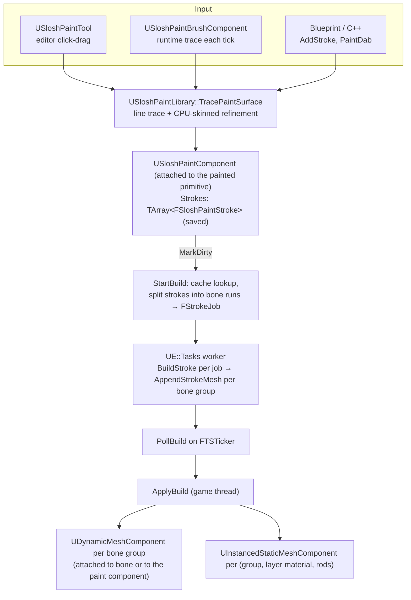

# Slosh Paint

Slosh Paint lays procedural liquid strokes (honey drips, glaze, milk, slime, water drops) onto any surface: static
meshes, skeletal meshes and anything with collision. It ports the Blender add-on **Fluid Painter** (by Miki3d; version
1.2.20 was studied) to Unreal.

It is **mesh-based and not simulated**. A stroke is a list of points; a worker thread turns it into a smooth triangle
mesh with a deterministic geometry pipeline. Nothing flows, and nothing touches the FLIP solver. Each paint preset is
nonetheless also a Slosh liquid material, so the same asset can drive a simulated `ASloshVolume` (§9).

Related pages: [Rendering](Rendering.md) (Mesh surface mode, which can draw a volume with a paint material),
[Materials](Materials.md), [Reference](Reference.md), [Testing](Testing.md) (`-SloshPaintTest`),
[Architecture](Architecture.md). Background design: `Research/PAINTER_DESIGN.md`. It is milestone-based and mostly
matches the code; the code wins where they differ.

---

## 1. Files

| Module | File | Contents |
|---|---|---|
| Slosh | `Public/SloshPaintTypes.h` | `FSloshPaintPoint`, `FSloshPaintStroke` |
| Slosh | `Public/SloshPaintPreset.h` | `USloshPaintPreset` (derives from `USloshMaterialAsset`), `FSloshPaintLayer`, `ESloshPaintDropMode` |
| Slosh | `Public/SloshPaintComponent.h`, `Private/SloshPaintComponent.cpp` | `USloshPaintComponent`: stroke storage, async build orchestration, generated components. Also defines `USloshPaintPreset::PostEditChangeProperty` and `OnPresetChanged`. |
| Slosh | `Private/SloshPaintMesher.h/.cpp` | `Slosh::Paint::BuildStroke`, `AppendStrokeMesh`: the pure-geometry stroke mesher (worker thread) |
| Slosh | `Public/SloshPaintLibrary.h`, `Private/SloshPaintLibrary.cpp` | `USloshPaintLibrary`: paint traces, CPU-skinned ray hits, `PaintDab` |
| Slosh | `Public/SloshPaintBrushComponent.h/.cpp` | `USloshPaintBrushComponent`: the runtime brush |
| Slosh | `Public/SloshPainterActor.h/.cpp` | `ASloshPainterActor`: drop-in painter (mouse or nozzle) |
| SloshEditor | `Private/SloshPaintEdMode.h/.cpp` | `USloshPaintEdMode` ("Slosh Paint" editor mode), commands, toolkit |
| SloshEditor | `Private/SloshPaintTool.h/.cpp` | `USloshPaintTool`, `USloshPaintToolBuilder`, `USloshPaintToolProperties` |
| SloshEditor | `Private/SloshEditorModule.cpp` | Registers the mode's commands |
| Content | `Plugins/Slosh/Content/Paint/...` (mounted as `/Slosh/Paint/`) | Presets, materials, Blueprints (§11) |

The mesher uses GeometryCore types (`FDynamicMesh3`, `FMarchingCubes`, `FDynamicMeshEditor`). Output is drawn with
`UDynamicMeshComponent` and `UInstancedStaticMeshComponent`.

---

## 2. Architecture



**Strokes are the saved source of truth.** All geometry lives in transient generated components. They carry
`RF_Transient | RF_TextExportTransient | RF_DuplicateTransient`, are owned by the painted actor and are rebuilt from the
strokes after load, undo, preset edits and so on.

---

## 3. Data model

### 3.1 `FSloshPaintPoint`

| Field | Meaning |
|---|---|
| `Position`, `Normal` | In the space of `Bone` on the painted skinned mesh. If `Bone` is None, in the **paint component's** space. Normals are unit length, rotation only (`InverseTransformVectorNoScale`). |
| `Pressure` | Bead-radius multiplier, clamped to [0.1, 5] |
| `Bone` | Dominant skin bone at the hit, or None. A bone is kept only if the paint component is attached to a `USkinnedMeshComponent` that has that bone. |

### 3.2 `FSloshPaintStroke`

| Field | Meaning |
|---|---|
| `Preset` | `USloshPaintPreset*`. A stroke has exactly one preset. |
| `Points` | `TArray<FSloshPaintPoint>` |
| `Seed` | `FMath::Rand()` at `BeginStroke`. Drives roughness jitter, drop phase and layer scatter. |
| `bVisible` | Hidden strokes are skipped by the build |
| `Id` | Unique within the component. Assigned from `NextStrokeId`. Ids that are missing or duplicated (e.g. strokes added in the details panel) are reassigned in `OnRegister`. |
| `Revision` | Transient. Bumped by `AddStrokePoint` and `EndStroke`; part of the geometry cache key. |

### 3.3 `USloshPaintComponent`

This is a `USceneComponent` attached to the painted primitive. `FindOrAddPaintComponent(Target)` returns an existing
child paint component, or creates one:
- **in an editor world**, as an `RF_Transactional` instance component, which is saved with the level;
- **at runtime**, as a plain component.

| Property | Default | Meaning |
|---|---|---|
| `Strokes` | — | Saved strokes |
| `Reveal` (`Interp`, setter `SetReveal`) | 1 | Fraction of each stroke's length that is drawn (0–1). Key it to pour paint on over time. |
| `DropTime` (`Interp`, setter `SetDropTime`) | 0 | Time input of animated drops (Fluid Painter "Drop Move") |
| `bAnimateDrops` | true | In game worlds, advance `DropTime` by `DeltaTime × DropTimeScale` every tick |
| `DropTimeScale` | 0.25 | DropTime units per second |
| `UnitScale` | 1 | Multiplies every preset unit on this component. Presets are millimetre-scale. |
| `QualityScale` | 1 | Meshing resolution multiplier (0.25–4). Higher = finer voxels and slower builds. |
| `OnPaintBuilt` | — | Fired after each applied build |

---

## 4. Units

Fluid Painter works in millimetres. The **preset unit** is:

```
Unit_cm = max(Preset.Scale, 0.1) × 0.1 × max(PaintComponent.UnitScale, 0.01)
```

`USloshPaintPreset::GetUnitCm()` returns the first part; `StartBuild` applies `UnitScale`. All preset lengths
(`Thickness`, `Offset`, `Fading`, drop sizes, layer `Size` and `Shift`) are in preset units. At `Scale = 1` and
`UnitScale = 1` a bead of `Thickness = 1` is 1 mm in radius before inflation, which is tiny in a UE scene. The demo
test uses `UnitScale = 6` and the editor validation used 8.

---

## 5. Meshing pipeline

### 5.1 Build scheduling (game thread)

```
any edit ──► MarkDirty(): bDirty = true; if no build in flight and registered → StartBuild()
StartBuild():
    for each visible stroke with a preset and points:
        Params = MakeParams(preset) (UnitCm × UnitScale)
        Key = hash(Revision, Points.Num, Params.Hash(), fluid material slot, Seed, Reveal, QualityScale [, DropTime if animated])
        cache hit (same Id, same Key) → reuse the cached pieces
        else → split into bone runs → FStrokeJob per run
    launch UE::Tasks "SloshPaintBuild" (raw FBuildState*)
    register PollBuild on FTSTicker::GetCoreTicker()  (ticks in the editor too)
PollBuild(): when the task completes → merge new pieces into Cache → ApplyBuild → OnPaintBuilt
             → if bDirty, StartBuild() again
```

- **One build in flight, coalesced.** Edits made while a build runs only set `bDirty`; exactly one more build follows.
- **What triggers a rebuild.**
  - `Begin`, `Add`, `End`, `RemoveStroke`, `UndoLastStroke`, `ClearStrokes`, `SetReveal`, and `SetDropTime` when an
    animated stroke exists.
  - `Rebuild()` (also a details-panel button), `NotifyStrokesChanged()`, `OnRegister`.
  - Editor `PostEditChangeProperty` and `PostEditUndo`, which clear the cache.
  - `USloshPaintPreset::OnPresetChanged`, broadcast from the preset's `PostEditChangeProperty`.
- **The cache key contains the point count and `Revision`, not the point data.** Code that edits `Strokes` directly
  must call `NotifyStrokesChanged(true)`, otherwise old geometry can be reused.
- `OnUnregister` waits for a running task, removes the ticker and destroys the generated components.

### 5.2 Worker: per stroke job

Each job builds one piece (one bone run) with `BuildStroke`. The worker then assembles all pieces, reused and new,
into one `FDynamicMesh3` per bone group with `AppendStrokeMesh`, and collects layer transforms per
`(material slot, rods)`.

`FDynamicMesh3`'s attribute set points back at its mesh, and UE containers move elements bitwise. Cache pieces
(`FSloshPaintStrokeCache::FPiece`) and bone groups (`FBuildState::FGroup`) are therefore held through `TUniquePtr`.
Holding them by value crashed in `AppendNormals` once there were more than about 10 bone groups.

### 5.3 `BuildStroke` step by step (`SloshPaintMesher.cpp`)

Notation: `U` = Unit (cm), `T = clamp(Thickness, 0.1, 5)`, `F = clamp(Flatness, 0, 1)`, `Q = clamp(Quality, 0, 2)`.

1. **Resample.**
   - Arc-length resampling at spacing `T·U`, with normals and pressure interpolated linearly.
   - At least 2 samples and at most 20,000.
   - A stroke with a single point, or of zero length, becomes one sample: a dab.
2. **Drop window** (`DropMode = Animated` only).
   ```
   L         = clamp(DropLength, 0.01, 1)
   Base      = bDropMoveRandom  ? rand(DropMoveSeed·7919 + Seed)    : 1
   SpeedRand = bDropSpeedRandom ? rand(DropSpeedSeed·104729 + Seed) : 1
   Phase     = frac(Base/(L+1) + (DropMove + DropTime) · DropSpeed · SpeedRand)
   WindowEnd = Phase·(L+1);   WindowStart = WindowEnd − L
   FadeInOut fades the drop in and out at the stroke ends
   ```
3. **Blobs.** For each sample at normalised arc `u`:
   - **Reveal**: samples with `u > Reveal` are skipped.
   - **Roughness jitter**: `1 + Roughness·(rand·2 − 1)·0.5`.
   - **Profile**:
     - Static: over the last `L` of the stroke, `1 + (DropSize − 1)·((u − (1 − L))/L)^DropExponent`.
     - Animated: only samples inside the window are kept, with profile
       `DropSize·((u − WindowStart)/L)^DropExponent·FadeInOut`.
   - **Radius**: `R = U·clamp(T·Profile·clamp(Pressure·Jitter, 0.1, 5), 0.1, 5·T)`.
   - **Inflation**: Fluid Painter's points-to-volume radius, `Inflate = U·clamp(T, 0.5, 5)/(1 + 0.5·F)`. Flat, sunk
     presets such as Glaze+ need it to rise above the surface.
   - **Ellipsoid**:
     - tangential semi-axis `A = R + Inflate`;
     - normal semi-axis `C = R·(1 − 0.99·F) + Inflate`;
     - centre = surface point + `N·Offset·U`.
     The frame is the neighbour tangent projected onto the surface plane, its binormal, and the surface normal.
4. **Voxel size.**
   ```
   Voxel = U·clamp(T, 0.5, 5) / ((1 + 0.5F)(2 + Q))
   Voxel = min(Voxel, mean(A)/(3 + Q)) / QualityScale
   C     = max(C, 0.75·Voxel)            // flattened blobs stay resolvable
   Blend = 0.35·mean(A)                  // smooth-union width
   ```
   The bounds are padded by `2·Voxel`. If they exceed `MaxCellsPerStroke` (4 Mi cells), the voxel size grows by the
   cube root of the excess.
5. **Implicit surface.**
   - Distance function: polynomial smooth-min (width `Blend`) of Inigo Quilez's ellipsoid distance bound over nearby
     blobs.
   - Blob lookup: a uniform bucket grid (`FBlobGrid`, cell `2·maxA + Blend`). Each blob is inserted into every cell
     its padded bounds overlap.
   - Polygonised by `FMarchingCubes` (iso 0, `bParallelCompute`).
6. **Winding.**
   - Unreal is left-handed, and GeometryCore's triangle normal is `(C − A) × (B − A)`, so an outward-wound closed
     mesh has a **negative** `Σ A·(B × C)`.
   - If the sum is positive, every triangle is reversed.
7. **Smoothing.**
   - `SmoothIterations` (0–64) Taubin λ/μ pairs (λ = 0.5, μ = −0.53).
   - Plain Laplacian shrank thin beads well below their designed radius; Taubin preserves volume.
8. **Attributes.**
   - Per-vertex normals; `MaterialID` = the fluid material's slot in the build's material table.
   - **UV0** = (`clamp(height / (Fading·U), 0, 1)`, `arc / U`). The height is measured along the normal of the nearest
     blob's surface point and drives the material's fading ramp.
   - **UV1** = object `xy`, **UV2** = (object `z`, 0). The object coordinates are in group space (bone or paint
     component), scaled by `0.01 · MaterialUVScale / EffectiveScale`, with `EffectiveScale = U / 0.1`. Procedural
     noise therefore keeps its size relative to the liquid.
9. **Layers A/B.**
   - Area-weighted random scatter over the stroke's triangles.
   - Density: `Amount / EffectiveScale² × 10⁵` instances per m². Count = `round(density × area_cm² × 1e‑4)`, capped at
     `MaxLayerInstancesPerStroke` (4000).
   - Each instance is oriented to the triangle normal and has radius `Size·U·((1 − SizeRandom) + SizeRandom·U(0.1, 1))`.
   - It is pushed in by `Size·U` when `bInside`, then shifted by `Shift·U`.
   - Rods get a random extra rotation and scale `(0.3S, 0.3S, 2S)`.
   - A layer is active only when `bEnabled` and its `Material` is set.

### 5.4 `ApplyBuild` (game thread)

**Group meshes.**
- There is one `UDynamicMeshComponent` per bone group. The key is the bone name; None is the paint component's own
  group.
- Components of groups that persist are reused; stale ones are destroyed. A new component is attached to
  `(SkinnedMesh, Bone)` or to the paint component.
- Settings: no collision, `AutoCalculated` tangents.
- Material set = the build's material table (every fluid and layer material, deduplicated). Triangle `MaterialID`
  picks the slot.
- Shadows: cast only if any stroke in that group uses a preset with `bCastShadows`. The default is false, matching
  Fluid Painter's shadow-transparent materials.

**Layer instances** are rebuilt from scratch on every build.
- There is one `UInstancedStaticMeshComponent` per (group, layer material, rods), using `/Engine/BasicShapes/Sphere` or
  `/Engine/BasicShapes/Cylinder`.
- Instance transforms are rescaled for the engine shapes' sizes: radius 50, cylinder height 100.
- Layer instances never cast shadows.

---

## 6. Skinned meshes

**Storage.** When the paint component's attach parent is a `USkinnedMeshComponent`, each point records the dominant
bone at its hit. It is stored in that bone's world transform: `GetSocketTransform(Bone, RTS_World)`, then the inverse.

**Bone runs.** At build time each stroke is split into **runs of consecutive points that share a bone**.
- Each run becomes its own job, built in that bone's space. Its seed is `Stroke.Seed + runIndex·977`.
- Each run includes the neighbouring point on either side, converted into the run's bone space **with the current
  pose**, so the pieces meet without a gap.

**Attachment.** Each bone group's mesh is attached to its bone. The paint follows the animation with **no per-frame
meshing**: it is rigid per bone.
- At strongly bending joints, pieces of neighbouring bones can open up or interpenetrate.
- Smooth (weighted) skinning of paint is planned (milestone 3 in `PAINTER_DESIGN.md`).

**Hit refinement.** `USloshPaintLibrary::TracePaintSurface` runs a normal `LineTraceSingleByChannel`. It then tests the
**rendered skin** of every registered, visible `USkinnedMeshComponent` in the world whose bounds the ray crosses.
Physics capsules are only an approximation of the skin. When `bIncludeSkinnedWithoutCollision` is set, meshes with no
collision are tested too. A skin hit replaces the physics hit if it is closer, or if it is on the same component.

`TraceSkinnedSurface`:
- **CPU skinning.** Skins **all LOD0 vertices** on the CPU with `GetSkinnedVertexPosition` and `CacheRefToLocalMatrices`.
  The result is cached for one component per frame.
- **Ray test.** Brute-force ray/triangle (Möller–Trumbore) over every enabled render section, in component space.
- **Normal.** The geometric normal, flipped toward the ray.
- **Bone.** The vertex with the largest barycentric weight is taken, and its largest skin-weight influence is mapped
  through the section's `BoneMap`.
- **CPU access.** It needs CPU-readable render data: always available in the editor; at runtime enable **Allow CPU
  Access** on the skeletal mesh. Without it, the function returns false and painting falls back to physics-body hits
  and their `BoneName`.

---

## 7. Animation and Sequencer

- `Reveal` and `DropTime` are `Interp` properties with `BlueprintSetter`s (`SetReveal`, `SetDropTime`). Sequencer
  property tracks call the `Set<Property>` function, which marks the paint dirty.
- **Reveal** rebuilds every visible stroke, because Reveal is in every cache key. Plan for the CPU cost on scenes with
  many strokes.
- **DropTime** rebuilds only strokes whose preset has `DropMode = Animated`.
- In game worlds `bAnimateDrops` advances `DropTime` every tick. The rebuild is asynchronous, so animated drops update
  at the rate builds finish: long strokes can lag a frame or two.

---

## 8. Blueprint and C++ API

### 8.1 `USloshPaintComponent`

| Function | Notes |
|---|---|
| `static FindOrAddPaintComponent(USceneComponent* Target)` | `DefaultToSelf` |
| `int32 BeginStroke(Preset, WorldLocation, WorldNormal, Pressure = 1, Bone = None)` | Returns the stroke id |
| `bool AddStrokePoint(StrokeId, WorldLocation, WorldNormal, Pressure = 1, Bone = None)` | |
| `void EndStroke(StrokeId)` | Bumps `Revision`; final rebuild |
| `int32 AddStroke(Preset, WorldLocations, WorldNormals, Pressure = 1, Bone = None)` | `WorldNormals`: one per point, one for all, or empty (up) |
| `bool RemoveStroke(StrokeId)`, `UndoLastStroke()`, `ClearStrokes()` | |
| `SetReveal(float)`, `SetDropTime(float)` | |
| `Rebuild()` | `CallInEditor`. Clears the cache. |
| `GetNumStrokes()`, `IsBuilding()` | |
| C++ only: `GetStrokeSpaceTransform(Bone)`, `GetSkinnedTarget()`, `FindStroke(Id)`, `NotifyStrokesChanged(bClearCache)` | |

### 8.2 `USloshPaintLibrary`

- **`TracePaintSurface(WorldContext, Start, End, TraceChannel, ActorsToIgnore, bIncludeSkinnedWithoutCollision = true)`**
  returns an `FSloshPaintHit`: `bHit`, `Location`, `Normal`, `Component`, `Bone`, `Distance`. Generated paint
  components have no collision, so paint never blocks the ray.
- **`TraceSkinnedSurface(Component, Start, End, OutLocation, OutNormal, OutBone, OutDistance)`** intersects the ray
  with the skin only.
- **`PaintDab(Hit, Preset, Pressure = 1)`** paints a one-point stroke, for projectile impacts and splats.

### 8.3 `USloshPaintBrushComponent`

While `IsPainting()`, each tick:
1. It builds an aim ray (`GetAimRay`):
   - `ComponentForward`: along the component's forward axis, `MaxDistance` (2000 cm). The owner is ignored by the
     trace.
   - `MouseCursor`: through the mouse cursor of `AimController`, defaulting to player 0.
   - `ScreenCenter`: from the camera through the screen centre.
2. It calls `PaintAlongRay`, which traces with `TracePaintSurface`.
3. It **starts a new stroke whenever the hit component changes** or the ray leaves the surface.
4. It adds a point once the hit has moved `EffectiveSpacing()`. That is `Spacing` if set, otherwise
   `max(0.5 · Thickness · GetUnitCm(), 0.02)` cm.

Events: `OnStrokeStarted` and `OnStrokeFinished` (`PaintComponent`, `StrokeId`). Other properties: `Preset`,
`Pressure` (0.1–5), `TraceChannel` (Visibility), `bPaintSkinnedWithoutCollision`. Note that `EffectiveSpacing` uses the
preset's `GetUnitCm()` without the target component's `UnitScale`.

### 8.4 `ASloshPainterActor`

A drop-in painter, and the base of `BP_SloshPainter` and `BP_SloshNozzle`. It owns a `Brush` (aim `MouseCursor`) and,
in the editor, an orange aim arrow.

| Property | Meaning |
|---|---|
| `Presets` | The list cycled by keys 1–9 and Tab. The first is selected at BeginPlay if the brush has none. |
| `bMouseInput` | Binds player 0's input: LMB paints, mouse wheel changes pressure by `PressureStep` (0.1), 1–9 / Tab select a preset, Z undoes this painter's last stroke |
| `bAutoPaint` | Paints from BeginPlay. For a nozzle, set the brush's `Aim` to `ComponentForward`. |

Functions: `SelectPreset`, `NextPreset`, `UndoLastStroke` (pops this painter's own history), `GetPresetIndex`.
Switching preset mid-stroke ends the stroke and starts a new one, because a stroke has exactly one preset.

### 8.5 Example (C++)

```cpp
#include "SloshPaintComponent.h"
#include "SloshPaintLibrary.h"

void PaintDrip(UObject* WorldContext, USloshPaintPreset* Honey, const FVector& From, const FVector& Dir)
{
    TArray<FVector> Locations, Normals;
    USceneComponent* Target = nullptr;
    FName Bone;
    for (int32 I = 0; I < 12; ++I)
    {
        const FVector Start = From + FVector(0, 0, -2.0 * I) - Dir * 50.0;
        const FSloshPaintHit Hit = USloshPaintLibrary::TracePaintSurface(WorldContext, Start, Start + Dir * 100.0,
            ECC_Visibility, {}, true);
        if (!Hit.bHit || (Target && Hit.Component != Target)) { break; }
        Target = Hit.Component;
        Bone = Hit.Bone;   // AddStroke takes one bone for all points; use Begin/AddStrokePoint for per-point bones
        Locations.Add(Hit.Location);
        Normals.Add(Hit.Normal);
    }
    if (Target)
    {
        USloshPaintComponent* Paint = USloshPaintComponent::FindOrAddPaintComponent(Target);
        Paint->UnitScale = 6.0f;   // presets are millimetre-scale
        Paint->AddStroke(Honey, Locations, Normals, 1.0f, Bone);
    }
}
```

On skeletal meshes, prefer `BeginStroke` / `AddStrokePoint` with each hit's own `Bone`, as the brush does, so a stroke
across several bones is split correctly.

---

## 9. Presets are also liquid materials

`USloshPaintPreset` derives from `USloshMaterialAsset`, so every preset carries `Physical` (solver) and `Visual`
(renderer) sections next to its paint parameters. Assign a preset to an `ASloshVolume`'s **Material** slot and:

- the solver uses `Preset->Physical`, which is tuned per liquid type (density, viscosity, friction, adhesion and so on;
  the values live in the assets);
- the screen-space renderer uses `Preset->Visual`. Every shipped preset stores the "viscous look": smoothing 24/4/3,
  anisotropy 0.85, edge fade 1.5 cm, scatter lighting 1, particle radius 0.9. See
  [Rendering §12.2](Rendering.md#122-the-two-reference-looks);
- in **Mesh** surface mode, with `SurfaceMaterial` empty, the surface mesh draws with the preset's paint `Material`
  (`ASloshVolume::GetEffectiveSurfaceMaterial`). The surface-nets mesh does not supply the fading and object-coordinate
  UVs the paint materials expect, so the match is approximate ([Rendering §8.4](Rendering.md#84-usloshsurfacemeshcomponent-and-its-proxy)).

The demo flag `-SloshSkelPreset=Honey` loads `/Slosh/Paint/Presets/Regular/DA_SloshPaint_Honey` as a volume's material
(see [Testing](Testing.md)).

---

## 10. Preset reference (`USloshPaintPreset`)

Every parameter mirrors a Fluid Painter geometry-node input one to one, so presets port directly. Lengths are in preset
units (§4).

| Category | Property | Default | Meaning |
|---|---|---|---|
| Preset | `Category` | — | Grouping name |
| Preset | `bAdultContent` | false | Marks adult-content presets, kept in a separate content folder so they can be excluded |
| Fluid | `Material` | — | The paint material (an `MI_SloshPaint_*` instance) |
| Fluid | `MaterialUVScale` | 1 | Scale of the procedural material features relative to the liquid |
| Fluid | `Scale` | 1 | Preset unit = `Scale × 1 mm` |
| Fluid | `Thickness` | 1 | Bead radius and resampling spacing (0.1–5), multiplied by pressure |
| Fluid | `Quality` | 0 | Meshing resolution: 0 = Fluid Painter default, 2 = finest |
| Fluid | `Roughness` | 0 | Random bead-radius variation |
| Fluid | `Flatness` | 0 | 0 = round beads, 1 = flat film |
| Fluid | `Offset` | 0 | Shift along the surface normal (negative sinks the stroke) |
| Fluid | `Fading` | 1 | Height range of the material's fading ramp (UV0.x) |
| Fluid | `SmoothIterations` | 10 | Taubin smoothing passes (0–64). The header comment says "Laplacian". |
| Fluid | `bCastShadows` | false | Whether the group mesh casts shadows |
| Drops | `DropMode` | None | `None`, `Static` (bulb at the end), `Animated` (travelling droplet only) |
| Drops | `DropLength` | 0.5 | Fraction of the stroke the drop covers |
| Drops | `DropSize` | 2 | Drop radius relative to the bead (1–5) |
| Drops | `DropExponent` | 1 | 1 = cone, higher = rounder bulb at the very end |
| Drops | `DropMove`, `bDropMoveRandom`, `DropMoveSeed` | 0, false, 0 | Phase offset of animated drops (added to `DropTime`), optionally random per stroke |
| Drops | `DropSpeed`, `bDropSpeedRandom`, `DropSpeedSeed` | 1, false, 0 | Animated drop speed in stroke lengths per DropTime unit, optionally random per stroke |
| Layers | `LayerA`, `LayerB` (`FSloshPaintLayer`) | disabled | `bEnabled`, `bRods`, `Material`, `bInside`, `Size`, `SizeRandom`, `Amount`, `Shift`, `Seed` (§5.3 step 9) |
| (inherited) | `Physical`, `Visual` | — | `USloshMaterialAsset` sections (§9) |

`GetUnitCm()` returns `max(Scale, 0.1) × 0.1`. In the editor, `PostEditChangeProperty` broadcasts the static
`USloshPaintPreset::OnPresetChanged`, and every paint component using the preset rebuilds.

---

## 11. Content (`/Slosh/Paint/`)

```
Content/Paint/
├── Blueprints/
│   ├── BP_SloshPainter          mouse-cursor painter, regular presets on keys 1–9
│   ├── BP_SloshPainter_NSFW     same painter configured with the adult-content pack
│   └── BP_SloshNozzle           auto-paints along its forward axis (orange aim arrow)
├── Materials/
│   ├── M_SloshPaint_Opaque      master: Subsurface shading, dithered opacity mask (facing/fading ramps)
│   └── M_SloshPaint_Translucent master: forward-shaded translucency with refraction, Fresnel, tint
└── Presets/
    ├── Regular/                 34 DA_SloshPaint_* data assets + Materials/ (33 MI_SloshPaint_* instances)
    ├── NSFW/                    adult-content pack: 9 data assets (bAdultContent) + Materials/ (8 instances)
    └── Layers/Materials/        MI_SloshPaintLayer_BubblesAir, _BubblesSoap, _Sugar, _SugarColored
```

The master-material descriptions come from `PAINTER_DESIGN.md` §3; open the assets for the exact graphs. One master
detail that is easy to get wrong: UE's Subsurface model adds `SubsurfaceColor` to diffuse even at full density, so the
opaque master feeds `SubsurfaceColor × SubsurfaceAmount` and uses `Opacity = 1 − SubsurfaceAmount`. Wiring it
differently rendered dark presets white.

**Regular pack** (`Presets/Regular/DA_SloshPaint_*`): Biscuit, BloodPlus, ChocolateBrown, ChocolateWhite, Default,
DefaultPlus, Foam, Glaze, GlazePlus, Glitter, Gummy, Honey, HoneyPlus, Ketchup, Lube, MapleSyrup, MapleSyrupPlus, Mayo,
MetalGold, MetalSilver, Milk, MilkPlus, MudPlus, Mustard, OilCrudePlus, OilPlus, Slime, SlimeGlowing, Soap, SoapPlus,
WaterDrops, WaterDropsAnim, WaterPlus, Wax. `WaterDropsAnim` reuses `MI_SloshPaint_WaterDrops`. "Plus" variants are
Fluid Painter's richer versions of the base liquid.

**Adult-content pack.** A separate pack lives in `Presets/NSFW/` with its own painter Blueprint. Every asset in it has
`bAdultContent = true`. The folder can be excluded from packaging or distribution without affecting anything else.

---

## 12. Editor mode and tool

**Mode.** `USloshPaintEdMode` (`EM_SloshPaint`, label "Slosh Paint", mesh-paint icon) is a `UEdMode`, discovered
automatically by the editor's mode registry. `SloshEditorModule` registers `FSloshPaintEdModeCommands`, which provides
one command, **Paint**. On `Enter` the mode registers and activates `USloshPaintTool` on the left side. The toolkit
(`FSloshPaintEdModeToolkit`) shows the tool palette and the tool's properties.

**Tool properties** (`USloshPaintToolProperties`, persisted between sessions with `SaveProperties` /
`RestoreProperties`):

| Property | Meaning |
|---|---|
| `Preset` | The liquid to paint. Painting without one shows a warning. |
| `Pressure` | Bead-radius multiplier (0.1–5) |
| `Spacing` | Minimum point distance in cm. 0 = `max(0.5 · Thickness · Unit · Pressure, 0.02)`. |
| `bPaintSkinnedWithoutCollision` | Also hit skeletal meshes that have no collision |

**Behaviour.**
- **Hover.** A `UMouseHoverBehavior` traces under the cursor and draws a brush preview: a circle of the bead radius, a
  larger fixed-minimum reticle and a normal line.
- **Drag.** A `UClickDragInputBehavior` traces `ECC_Visibility` 1e6 cm along the view ray with `TracePaintSurface` on
  press and on every drag event.
- **Undo.** Each drag is **one undo transaction**, "Slosh Paint Stroke".
  - `Owner->Modify()` and `Paint->Modify()` run before the first point on each new target, so undo restores the
    pre-stroke strokes, and `PostEditUndo` rebuilds the geometry.
  - Moving onto another surface mid-drag ends the stroke and starts one on the new target, inside the same
    transaction.
- **Saving.** Strokes are stored on an instance `USloshPaintComponent` added to the painted actor and saved with the
  level. The generated geometry is not saved and is rebuilt on load.

The brush preview radius is `Thickness × GetUnitCm() × Pressure`. It does not include the target component's
`UnitScale`, so on components with `UnitScale ≠ 1` the preview circle understates the bead.

---

## 13. Performance and limits

- **Meshing is CPU work.** It runs on a worker task, and marching cubes runs in parallel inside it. The cost per
  stroke scales with its volume in voxels, capped at 4 Mi cells by coarsening the voxel. Layers are capped at 4000
  instances per stroke.
- **Rebuild scope.** Any change rebuilds every stroke whose key changed. `Reveal` animation rebuilds all strokes;
  `DropTime` rebuilds only animated ones. All strokes in a bone group are merged into one mesh, so the component's
  mesh is re-uploaded whenever any of its strokes changes.
- **Paint traces.**
  - Each trace walks every `USkinnedMeshComponent` in memory (`TObjectIterator`) and filters by world, visibility and
    bounds.
  - A skin test CPU-skins all LOD0 vertices, cached per frame for only one component, then tests every triangle.
  - Painting near many skinned characters, or alternating between two, costs noticeable game-thread time.
- **Rigid per-bone pieces.** The paint does not stretch with skin deformation (§6).
- **Not simulated.** Paint does not flow, drip over time or interact with Slosh volumes. A simulated mode (milestone 2
  in `PAINTER_DESIGN.md`) is planned.
- **Cache key.** It ignores point data and bone pose (§5.1). External edits to `Strokes` need
  `NotifyStrokesChanged(true)`.

---

## 14. Open question: preset redistribution rights

The presets' geometry values and material graphs were ported from Fluid Painter, a **paid** Blender add-on whose
downloads carry no license text. The project chose to ship the ported presets inside the plugin, and the repository is
public. **Confirm redistribution rights with the add-on's author before publishing or pushing preset content**
(`Content/Paint/Presets/**` and the master materials). This is listed under Risks in `Research/PAINTER_DESIGN.md` §5;
see also `Research/LICENSING_AUDIT.md`.

---

## 15. Code notes worth knowing

- **Comments say Laplacian, code is Taubin.** `SloshPaintPreset.h:174` and `SloshPaintMesher.h:11` describe the
  smoothing as Laplacian; `SloshPaintMesher.cpp:350-378` implements Taubin λ/μ.
- **Cache key.** `SloshPaintComponent.cpp:427-436` keys the geometry cache on `Revision` and the point count only
  (§5.1). The one-point overlap between bone runs is converted with the pose at build time and then cached.
- **Unit scale ignored by the brushes.** `SloshPaintTool.cpp:269` (preview radius and auto spacing) and
  `SloshPaintBrushComponent.cpp:317` (auto spacing) ignore the target component's `UnitScale`.
- **Inconsistent spacing.** The runtime brush's auto spacing ignores pressure; the editor tool's includes it.
- **Trace cost.** `SloshPaintLibrary.cpp:87` keeps a single-entry skinned-vertex cache, and `SloshPaintLibrary.cpp:261`
  iterates every skinned component on every trace (§13).
